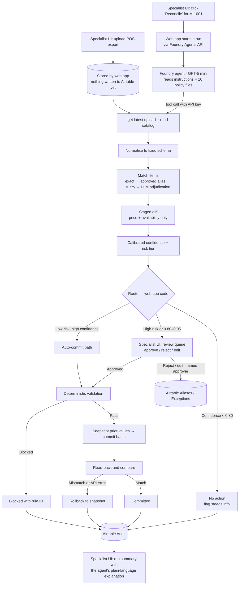
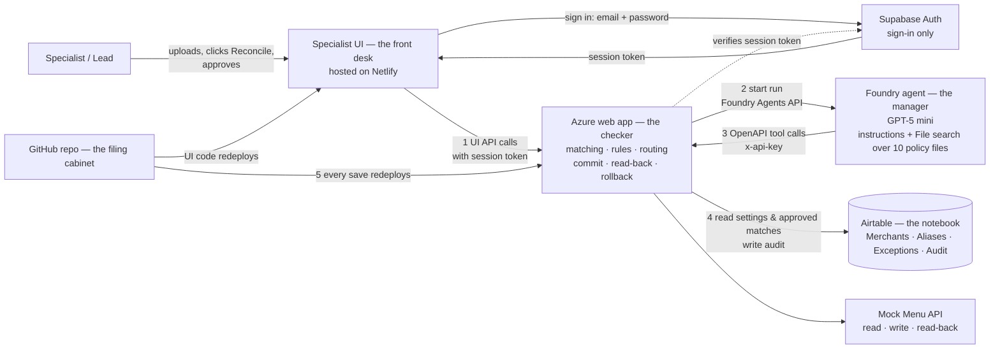

# DoorDash Menu Reconciliation Agent — Product Requirements Document

| | |
|---|---|
| **Author** | Aish, AI Product Management cohort (capstone) |
| **Version / date** | v1.2, 18 October 2026 (v1.1 and v1.0: 5 October 2026) |
| **Status** | Draft for manager review |
| **Primary persona** | Merchant Operations Specialist |
| **MVP scope** | Price mismatches and item-availability mismatches only, per manager feedback |
| **MVP flow** | Staged diff → confidence score → human approves high-risk changes → deterministic validation before commit → rollback on failure |
| **Build** | Specialist UI (separate front end on Netlify, Supabase Auth sign-in) → Azure web app → Azure AI Foundry agent (GPT-5 mini) + Airtable memory, deployed from GitHub |
| **Data** | Public and synthetic data only. No DoorDash systems or merchant data are used in this capstone |

**One-line summary.** An agent compares a merchant's POS menu with its DoorDash menu, stages every price and availability difference as a reviewable diff, auto-commits only the low-risk, high-confidence changes, sends the risky ones to a person, validates everything with deterministic code before it writes, and rolls back if anything fails.

> **The idea to remember: the AI proposes, the code decides.** The Foundry agent suggests changes and explains them. The web app is the one that approves, blocks or routes each change to a human.

### What changed in v1.2

- **One interface for the specialist.** Everything the specialist does now happens in the **Specialist UI**, a separate front end: upload, reconcile, review and approve, history. The lead's settings live there too. Specialists no longer chat with the agent in the Foundry portal.
- **The agent runs behind the UI from the MVP.** Clicking **Reconcile** asks the Azure web app to start a Foundry agent run through the Foundry Agents API. The agent plans and calls the web app's tools as built, and its explanations appear in the UI. Approvals go straight from the UI to the web app, with no agent in that path.
- **The front end talks only to the web app.** The API key, the Foundry credentials and the Airtable token stay on the server. Specialists sign in to the UI, and the web app checks their role.
- **Hosting and sign-in decided (same approach as the ContractIQ PRD):** the Specialist UI is hosted on **Netlify**. Sign-in uses **Supabase Auth** (email and password, with email verification). The web app checks the Supabase session token on every UI call. Supabase is used for sign-in only; menu data, memory and audit stay in the web app and Airtable.
- **Removed:** the Foundry chat as the specialist's entry point, and the "approve in chat" stopgap. The upload page and demo controls move into the Specialist UI.

### What changed in v1.1

Items marked **[New]** are new sections. Items marked **[Proposed]** are starting values for review, not validated numbers. Items marked **[Verify]** need checking against the live build or an official price page.

- **Tech stack updated to the as-built Foundry prototype** (see the Menu Agent Build Map): a Foundry agent on GPT-5 mini with File search over 10 policy files, an Azure web app exposing 10 tools via OpenAPI, Airtable as memory (4 tables), GitHub-to-Azure deployment, and an API key. This replaces the earlier Python state machine, Streamlit, Postgres and VM, and the Claude Haiku/Sonnet prompt chain.
- **Approval queue** replaces Streamlit; still to be built (in v1.2, part of the Specialist UI).
- **Roadmap set to 12 weeks:** MVP 6 · MVP 1 3 · Launch 3. It now matches the 12-week manpower cost.
- **Beta precision gate** stays at 300 decisions, with the honest Wilson lower bound (≈97.1%) stated.
- **Pricing recalculated** for GPT-5 mini and Azure/Airtable hosting. The cost-by-scale curve is rebuilt, and each revenue scenario uses its own point on the curve.
- **Alias/exception memory and per-merchant autonomy levels moved into the MVP**, because the build already has them (Airtable Aliases, Exceptions and Merchants tables).
- **[New] sections:** Architecture & data model, Constraints, External dependency risks, Business-outcome and adoption metrics, Approval queue UI and error states, Stale-approval handling, Operations lead persona, Customer communication plan, Fairness data and collection plan, Current build status.

---

## Table of Contents

1. [Problem Definition](#1-problem-definition)
2. [Solution Definition](#2-solution-definition)
3. [Architecture & Data Model](#3-architecture--data-model) **[New]**
4. [Constraints](#4-constraints) **[New]**
5. [Prioritization](#5-prioritization)
6. [Roadmap](#6-roadmap)
7. [Implementation Plan — Evaluation Strategy](#7-implementation-plan--evaluation-strategy)
8. [Evaluations (HHH) & Launch Plan](#8-evaluations-hhh--launch-plan)
9. [Data Requirements & Prompt Strategy](#9-data-requirements--prompt-strategy)
10. [Responsible AI Risks & Mitigation](#10-responsible-ai-risks--mitigation)
11. [Pricing](#11-pricing)
12. [Assumptions & Open Questions](#12-assumptions--open-questions)
13. [Sources](#13-sources)

---

## 1. Problem Definition

### What problem is this solving?

A merchant's menu lives in two places: the point-of-sale (POS) system, which is where prices and stock are actually changed, and the DoorDash catalog, which is what consumers see and order from. The two drift apart. A price edit made in the POS never reaches DoorDash. An item sells out in the kitchen but stays orderable. A Merchant Operations Specialist then reconciles by hand: export the POS menu, line it up against the DoorDash menu in a spreadsheet, and fix each item in the portal one at a time.

That manual loop is slow, and it breaks in two ways that cost money. An unavailable item that stays live leads to order cancellations, refunds and a worse consumer experience. A wrong price leads to margin loss for the merchant or an overcharged consumer, and both end up as support contacts. Fixing it fast matters, but a wrong automated fix can be worse than the original drift, so the product has to be precise before it is fast.

**Job to be done**

> When a merchant's POS and DoorDash menu disagree on price or availability, I want to see exactly which items differ, have the safe fixes applied automatically and approve the risky ones in seconds, so that the live menu is correct without hours of spreadsheet work and without introducing new errors.

**MVP scope (narrowed per manager feedback)**

| | In scope | Out of scope for MVP |
|---|---|---|
| **Change types** | Price mismatch on an existing item. Item availability (in stock / out of stock). | New items, descriptions, photos, modifiers and option groups, taxes, promotions, categories. |
| **Merchants** | Single-location, English-language, US-style menus with a CSV/JSON POS export. | Chains, multi-location, non-English menus, merchants without a POS export (needs OCR, Phase 1+). |
| **Autonomy** | Conditional: low-risk and high-confidence changes auto-commit, everything else goes to a human. | Fully unattended operation on any change type. |

### Who are you solving this problem for?

**Primary persona: Merchant Operations Specialist (MOS)**

| | |
|---|---|
| **Who** | DoorDash (or BPO-partner) operations specialist who owns a book of roughly 150–300 merchants (planning assumption, to be validated in discovery interviews). |
| **Day to day** | Receives menu-sync tickets and merchant requests, downloads POS exports, compares them to the DoorDash menu in a spreadsheet, edits items one by one in the merchant portal, then spot-checks the live menu. |
| **Pain** | Repetitive item-by-item comparison. Naming differences between systems ("Lg Marg Pizza" vs "Margherita Pizza, Large"). Fear of changing the wrong item. No audit trail of what changed and why. |
| **Gain from the agent** | A ready diff with evidence and confidence per change. Safe changes handled automatically. Only the risky ones need a decision. Everything is logged and reversible. |
| **Success looks like** | Reconciliation for a merchant drops from about 25 minutes per month to 10 minutes or less, with no new errors reaching the live menu. |

**Secondary persona: Operations Team Lead [New]**

| | |
|---|---|
| **Who** | Leads a team of specialists and is accountable for menu accuracy and for any change the agent makes across the team's book. |
| **Day to day** | Sets team priorities, reviews quality samples, handles escalations from merchants, and decides when a process is trustworthy enough to automate. |
| **Pain** | Cannot see how accurate the team's menu fixes are. Has no safe way to delegate fixes to automation, and no way to stop or undo a bad batch quickly. |
| **Gain from the agent** | A settings area in the same Specialist UI with per-merchant autonomy levels (shadow, suggest, auto-low-risk), a dashboard split by auto and human path, a weekly audit sample, and a kill switch. |
| **Success looks like** | Widens autonomy only on measured precision, and can halt all writes in under 10 seconds if something goes wrong. |

**Other stakeholders and target market**

- **Merchant (beneficiary, no UI in MVP):** gets a correct menu and fewer cancelled orders. Merchant-facing controls come later.
- **Target market:** small and mid-size restaurants that run a POS alongside DoorDash, starting with single-location US restaurants. The same pattern extends to grocery and retail catalogs later.

### Why is this problem worth solving?

**Scale.** DoorDash has publicly reported 550K+ merchants (2023 figure, verify current). At that scale, every minute of reconciliation per merchant per month equals about 110,000 specialist-hours a year (550,000 merchants × 12 months ÷ 60). Even a small share of merchants with recurring drift makes this a large operations cost line.

**Cost of errors.** Stale availability and wrong prices turn into cancellations, refunds, support contacts and merchant churn risk. There is no public figure for DoorDash's menu-mismatch rate, so this PRD does not claim one. The baseline (25 minutes per merchant-month, 95% manual accuracy) is a planning assumption that Week-1 specialist interviews and shadow mode will replace with measured values.

**What else could solve it, and why it falls short**

| Option | What it does well | Where it falls short here |
|---|---|---|
| **Manual spreadsheet and portal edits (status quo)** | Humans catch odd cases. | Slow, repetitive, error-prone at scale, and leaves no structured audit trail. |
| **POS integrations and middleware (Deliverect, Otter, ItsaCheckmate-class tools)** | Deterministic sync once items are mapped. | Breaks when names drift or items are unmapped. Typically no confidence-gated routing, deterministic pre-commit validation story or rollback evidence for the long tail. |
| **ChatGPT, Claude or Copilot used ad hoc** | Can compare two spreadsheets and explain differences. | No write access, no validation, no audit trail, no per-merchant memory, and no measured precision. Not safe to commit changes. |
| **Rules and fuzzy matching only** | Cheap and fast on exact and near-exact names. | The ambiguous tail (size, combo and modifier variants) gets silently mismatched, which is the most expensive failure. |

**MOAT: what this does that a chat model or a competitor does not**

- **A governed write layer.** Staged diff, calibrated routing, deterministic validation and rollback, enforced by a web app the AI cannot argue with. The value is a system that can act safely, not an answer in a chat window.
- **Per-merchant alias and exception memory.** Every approve, reject or edit becomes a reusable mapping in Airtable, saved only after a named human approves, so the second run is cheaper and more accurate than the first. This is a data flywheel that a generic assistant does not have, and it improves without retraining.
- **Measured precision as a trust asset.** Each decision is labelled, so confidence thresholds are calibrated on real outcomes. That is what earns permission for more autonomy over time.
- **Workflow embedding.** The Specialist UI, with its review queue and audit trail, is where the specialist does the daily job, which raises switching cost.

*Honest caveat:* the moat is process and data, not the model, and the model is replaceable. The largest threat is DoorDash building this natively, which is why the product is framed as a forward-deployed internal tool for Merchant Operations rather than a stand-alone market bet.

### Why Agentic AI?

Names and menus differ between systems in ways rules cannot fully list: abbreviations, size and combo naming, reordered words, typos. A pure rules or fuzzy-matching system handles the easy majority and fails silently on the tail, and each wrong match becomes a wrong write. A model-only approach can match well but cannot be trusted to act. The product therefore combines both: **the LLM proposes, deterministic code disposes.**

| Need | Rules / ML-only system | Agentic system (LLM with tools and a plan) |
|---|---|---|
| **Match items across systems** | Exact and fuzzy match. Fails on drift and variants. | Deterministic candidates first, then an LLM adjudicates ambiguous pairs, cites evidence, or abstains. |
| **Decide what to do per change** | One global threshold. | Scores confidence and risk per change and routes: auto-commit, human approval, or no action. |
| **Multi-step work with tools** | Hard-coded pipeline. | Plans and calls tools: get latest upload, read catalog, match, stage, validate, commit, verify, roll back. |
| **Explain each change** | Match score only. | Plain-language reason plus evidence (row IDs, before and after values). |
| **Adapt to a new POS format** | New parser per format. | LLM maps unfamiliar columns to a fixed schema, which a validator then checks. |

**Where the LLM is not used:** arithmetic, threshold checks, validation rules, the commit itself and rollback. Those are deterministic code in the web app, because they must be exact and testable.

### How will you know that the problem is solved?

**Goal.** By the end of the 6-week MVP, on a replayed and synthetic evaluation set and a shadow-mode run: committed changes reach at least 98.5% precision (at least 99% on the auto-commit path), manual reconciliation time falls by at least 60% per merchant, and every injected failure is rolled back with no manual cleanup.

Metrics are tracked from the audit log (Airtable Audit table) and the review queue. Auto-committed and human-approved changes are always reported separately, because a blended number can hide a weak auto path.

**Product and system metrics**

| Metric | Type | Definition | Baseline | Target | How tracked |
|---|---|---|---|---|---|
| **Precision of committed changes** | North Star | Committed price and availability changes that are correct (matched the true POS value at audit) ÷ all committed changes. Split by auto path and human-approved path. | 95% manual accuracy (assumption; measured in shadow mode) | ≥99% auto path, ≥98.5% blended | Audit sample plus POS read-back at 7 days; Wilson 95% interval reported |
| **Manual reconciliation time** | Primary | Specialist minutes per merchant-month spent on reconciliation, including time spent approving. | 25 min (assumption; timed in discovery) | ≥60% reduction at launch (≤10 min); ≥75% at iteration | Time-and-motion study at pilot start, then queue timestamps |
| Auto-commit coverage | Secondary | Share of detected mismatches committed without a human. | n/a | 55–70% at launch | Routing log |
| Detection recall | Secondary | True mismatches that the agent surfaced (as a diff). | n/a | ≥90% | Gold set, then audit |
| Calibration error (ECE) | Guardrail | Gap between stated confidence and observed accuracy. | n/a | ≤0.05 | Weekly on labelled decisions |
| Rollback rate and success | Guardrail | Share of committed batches rolled back; share of rollbacks that restore prior values exactly. | n/a | Rollback rate <2%; success 100% | Commit log and read-back |
| Reviewer reject or edit rate | Guardrail | Share of human-reviewed changes that the reviewer rejects or edits. | n/a | <10% (higher means the queue is not trustworthy) | Approval queue |
| Cost per merchant-week | Guardrail | LLM and compute cost for one reconciliation run. | n/a | ≤$0.05 (modelled ≈$0.008 on GPT-5 mini) | Token and billing logs; Foundry tracing |

**Business-outcome and adoption metrics [New] [Proposed]**

These measure why the product exists, not only how the system performs. The capstone uses synthetic data, so they can only be measured from the Launch pilot onward. Baselines are taken in the first two pilot weeks.

| Metric | Type | Definition | Baseline | Target | How tracked |
|---|---|---|---|---|---|
| Menu-driven cancellation rate | Business outcome | Orders cancelled because an item was unavailable, per 1,000 orders, for pilot merchants. | Measured at pilot start | −25% vs baseline within 8 weeks of pilot | Order-cancellation reason codes |
| Menu-related support contacts | Business outcome | Support contacts tagged price or availability mismatch, per 1,000 orders. | Measured at pilot start | −20% vs baseline | Support ticket tags |
| Price-discrepancy refunds | Business outcome | Refund dollars attributed to wrong menu prices. | Measured at pilot start | Downward trend; no increase on auto-committed items | Refund reason codes |
| Mismatch age | Business outcome | Time from a POS change to the corrected live menu. | Measured in shadow mode | Median ≤3.5 days on a weekly run | Upload and commit timestamps |
| Specialist adoption | Adoption | Pilot specialists who run at least one reconciliation per week. | n/a | ≥80% | Run log |
| Specialist satisfaction | Adoption | Post-run rating: "Would you rather use the agent than the spreadsheet?" (1–5). | n/a | ≥4.0 average | In-app prompt after each run |

---

## 2. Solution Definition

### User Flows

The flow below shows what goes in, what happens at each step, and where a person is in the loop. The specialist works in **one place, the Specialist UI**: upload the POS export, click **Reconcile**, review and approve, see the result. The agent works behind the UI and the specialist never talks to it directly. The output is a set of committed changes, a queue of changes waiting for approval, and an audit log. Anything that fails validation or read-back is rolled back to a prior-value snapshot.

**How routing works**

| Change | Auto-commit when | Human approval when | No action when |
|---|---|---|---|
| **Price change** | Confidence ≥0.95 and the change is within ±10% and under $5 in absolute terms. | Confidence 0.80–0.95, or the change exceeds ±10% or $5. | Confidence <0.80, or no confident match. Flagged as "needs info". |
| **Mark item unavailable** | Confidence ≥0.90 and POS says out of stock (the conservative direction). | Confidence 0.80–0.90. | Confidence <0.80. |
| **Mark item available again** | Never in the MVP. | Always requires approval when confidence ≥0.80. | Confidence <0.80. |

*Thresholds are starting values. They are tuned on the gold set in shadow mode and then recalibrated weekly. Each merchant's autonomy level (shadow, suggest, auto-low-risk) is read from the Airtable Merchants table and can only narrow these rules, never widen them.*

**Onboarding and returning flows**

- **First run for a merchant (shadow mode):** the agent produces a diff but writes nothing. The specialist reviews it, and every decision seeds the merchant's alias and exception memory. After a clean shadow run the lead can raise the merchant to "suggest" and then "auto-low-risk".
- **Returning runs:** known aliases resolve deterministically first, so fewer items need the LLM. The diff shows only what changed since the last run, plus anything still pending.

### Specialist UI: screens and error states [New]

The Specialist UI is a separate front end that you build. It is the **only** interface for specialists and leads. It calls only the Azure web app's API; it never calls Foundry or Airtable directly and never holds the API key. The core screens are P0 because the MVP flow depends on them.

**Screens**

| Screen | Priority | What it does |
|---|---|---|
| Sign-in | P0 | Specialist or lead signs in with email and password (Supabase Auth, email verified on sign-up). Their role decides what they can see and do. Invalid credentials return a clear error. |
| Merchants | P0 | The specialist's book: each merchant's autonomy level, last run, pending approvals and status. Entry point for every action. |
| Upload | P0 | Upload a merchant's POS export (CSV/JSON). Replaces the web app's current upload page; same checks (success, wrong merchant, rejected rows). |
| Reconcile run | P0 | **Reconcile** button starts a run; progress shown step by step (reading upload, matching, staging, routing, committing). Ends on the run summary. |
| Review queue | P0 | Pending changes grouped by risk tier. Each row shows before and after values, POS row and catalog item IDs, match evidence, the agent's reason, confidence and age. One-click approve, reject or edit; bulk approve within a tier; the approver's name is recorded. |
| Run summary | P0 | Per run: committed, pending, blocked, skipped and rolled-back counts, the agent's plain-language explanation, links to audit rows. |
| History and audit | P0 | Searchable audit log per merchant with CSV export. |
| Lead settings | P0 (autonomy) / P1 (kill switch, dashboard) | Set autonomy level per merchant; global kill switch; metrics dashboard split by auto and human path. Lead role only. |
| Demo controls | Capstone only | Injects failures to demonstrate rollback. Moved from the web app into an admin-only area; not exposed in a pilot. |

**Empty and error states [Proposed copy]**

| State | Trigger | What the specialist sees |
|---|---|---|
| Nothing to review | No mismatches, or all auto-committed | "No changes need your review for M-1001. 12 low-risk changes were applied." Link to run summary. |
| No upload found | Reconcile clicked before any upload | Reconcile button disabled with: "Upload a POS export for M-1001 first." |
| Agent unavailable | Foundry run fails or times out | "We couldn't finish this run. Nothing was changed. Try again in a few minutes." Run marked failed in history. |
| Run in progress | Second Reconcile for the same merchant | "A run for M-1001 is already in progress." Only one run per merchant at a time. |
| Rows rejected at parse | Malformed rows in the POS export | Count and reason per rejected row (for example "price missing", "unknown column"), downloadable as CSV. Valid rows continue. |
| Needs info | No confident match | Listed separately from approvals: "We couldn't match these 4 POS items with confidence. Add an alias or skip." |
| Validation blocked | A change breaks a rule (FR-6) | Row shows the rule ID and plain reason, for example "Price is 6× the last known price (limit 5×)". It cannot be approved from the queue. |
| Batch rolled back | API error or read-back mismatch | Banner: "This batch was rolled back. All 18 items are back to their previous values (verified)." Link to audit rows. |
| Approval expired | Pending longer than the expiry window, or source data changed | "This change is out of date because the POS or menu changed. It has been re-staged." |
| Writes paused | Kill switch on | Banner on every page: "Writes are paused by your team lead. You can still review, but nothing will be applied." |
| Access denied | Not signed in, or role not allowed | "You don't have access to this." No merchant data is shown. |

### Functional Requirements

**User stories**

| ID | User story | Acceptance criteria | Priority |
|---|---|---|---|
| **US-1** | As a specialist, I want to upload a POS export and start a reconciliation from one screen so that I do not compare by hand. | The Specialist UI's Upload screen accepts CSV/JSON and a Reconcile button starts the run. Every row is parsed or rejected with a reason (100% accounted for). 500 items processed in under 30 seconds. | P0 |
| **US-2** | As a specialist, I want items matched across systems so that differences are attributed to the right item. | ≥95% of true pairs matched at ≥0.90 confidence on the gold set. Ambiguous items are flagged, never guessed. | P0 |
| **US-3** | As a specialist, I want a staged diff of price and availability mismatches so that I can see before anything changes. | Each row shows before, after, evidence, confidence and risk tier. Nothing is written to DoorDash until commit. | P0 |
| **US-4** | As an ops lead, I want low-risk, high-confidence changes to auto-commit so that specialists only handle what needs judgment. | Auto path precision ≥99% over ≥1,000 decisions (Wilson 95% lower bound ≥98%). Routing follows the policy table. | P0 |
| **US-5** | As a specialist, I want to approve, reject or edit high-risk changes quickly in the Specialist UI so that review is not a bottleneck. | Review queue screen with one-click approve, reject, edit. Bulk approve within a tier. Median review time ≤20 seconds per item. Approver name recorded. | P0 |
| **US-6** | As an ops lead, I want deterministic validation before any commit so that bad values never go live. | Every change passes all rules or is blocked. No code path skips validation. Rules are listed in functional requirements. | P0 |
| **US-7** | As an ops lead, I want automatic rollback on failure so that errors are contained. | Prior-value snapshot taken before commit. On any failure, prior values are restored within 60 seconds and verified by read-back. 100% of injected failures recover in testing. | P0 |
| **US-8** | As an auditor, I want a log of what changed, why and who approved it so that every change is traceable. | Each change logs source rows, evidence, confidence, route, approver, validation result, commit and rollback status. Exportable as CSV. | P0 |
| **US-9** | As a specialist, I want my corrections remembered so that the same mismatch does not return. | Reject or edit by a named approver creates an alias or exception rule for that merchant in Airtable. Repeat-error rate on the same item falls to <2% on the next run. | P0 (moved from P1: built) |
| **US-10** | As an ops lead, I want a dashboard of precision, time saved, rollback rate and calibration so that I can decide whether to widen autonomy. | Dashboard shows all metrics in the metrics tables, split by auto and human path. | P1 |
| **US-11a** | As an ops lead, I want a per-merchant autonomy level so that each merchant only gets as much automation as it has earned. | Levels: shadow, suggest, auto-low-risk, stored in the Airtable Merchants table and enforced by the web app. | P0 (moved from P1: built) |
| **US-11b** | As an ops lead, I want a global kill switch so that I can stop the agent immediately. | Kill switch halts all writes within 10 seconds; banner shown in the UI. | P1 |
| **US-12** | As a specialist, I want a daily digest of pending approvals so that nothing waits unseen. | Email or Slack digest lists pending items by age. | P2 |
| **US-13** | As a specialist, I want to handle merchants without a POS export by reading a menu photo or PDF. | Vision extraction with price-digit checks. Goes to approval by default. | P2 |
| **US-15 [New v1.2]** | As a specialist, I want to do everything in one screen so that I never switch between tools. | Upload, reconcile, review, approve, history and lead settings are all in the Specialist UI. No task requires the Foundry portal or Airtable. | P0 |
| **US-14 [New]** | As an ops lead, I want stale approvals to be re-checked so that an old decision never overwrites newer data. | Pending changes expire after 24 hours [Proposed]. Before any commit, the web app re-reads the latest POS upload and catalog; a changed item is re-staged, not committed. | P0 |

**Functional requirements**

| ID | Requirement | Traces to | Priority |
|---|---|---|---|
| FR-1 | Ingest a POS export (CSV/JSON) through the Specialist UI's Upload screen and a DoorDash catalog snapshot; normalise names, prices (currency, decimals) and availability into a fixed schema. | US-1 | P0 |
| FR-2 | Match POS items to catalog items: exact and approved-alias lookup first, fuzzy candidates second, LLM adjudication only for ambiguous pairs. Output a match or "no match", never a forced guess. | US-2 | P0 |
| FR-3 | Generate a staged diff of price and availability mismatches only. Store it as a versioned object that survives web app restarts. No external write until commit. | US-3 | P0 |
| FR-4 | Assign each change a calibrated confidence and a risk tier, and route it by the routing policy and the merchant's autonomy level. | US-4, US-5, US-11a | P0 |
| FR-5 | Review queue screen in the Specialist UI with approve, reject and edit, evidence panel, bulk-approve within a tier and named approver. | US-5 | P0 |
| FR-6 | Deterministic validation before every commit: price >0 and within 0.2×–5× of the last known price; valid currency and decimals; item ID exists and is unique; availability is a valid enum; no more than 25% of a menu changed in one batch; promo-locked and merchant-locked items (Airtable Exceptions) excluded; schema valid. | US-6 | P0 |
| FR-7 | Snapshot prior values before commit; commit as one batch; read back and compare; on any API error or mismatch, restore the snapshot and mark the batch rolled back. | US-7 | P0 |
| FR-8 | Append-only audit log (Airtable Audit table) for every commit, rollback and decision, with CSV export. Failure to write the audit row blocks the commit. | US-8 | P0 |
| FR-9 | Per-merchant alias and exception memory in Airtable, written only after a named human approves. | US-9 | P0 |
| FR-10 | Metrics dashboard and a global kill switch. | US-10, US-11b | P1 |
| FR-11 | Digest notifications for pending approvals. | US-12 | P2 |
| FR-12 | Vision/OCR ingestion for menu photos and PDFs, with digit-level price checks. | US-13 | P2 |
| FR-13 [New] | Approval expiry (24 h [Proposed]) and pre-commit re-check of the latest POS upload and catalog; changed items are re-staged. | US-14 | P0 |
| FR-14 [New] | Every web app tool called by the agent requires the API key (`x-api-key`); requests without a valid key return no merchant data. | US-1–US-9 | P0 |
| FR-15 [New v1.2] | The Specialist UI calls only the web app's API. The web app exposes UI endpoints (merchants, upload, start run, run status, review queue, decisions, history, settings) separate from the agent's tool endpoints. | US-15 | P0 |
| FR-16 [New v1.2] | Starting a run: the web app creates a Foundry agent run through the Foundry Agents API with a structured request (merchant ID, upload ID, run ID), using server-side credentials. One run per merchant at a time; runs time out and fail closed. | US-1, US-15 | P0 |
| FR-17 [New v1.2] | UI users sign in with Supabase Auth (email and password, email verification). The UI sends the Supabase session token with each call; the web app verifies it and enforces roles (specialist: upload, reconcile, review; lead: also settings and kill switch). Roles are stored in each user's Supabase app metadata and set by a lead or admin [Proposed]. The API key, Foundry credentials and Airtable token are never sent to the browser. | US-15, US-11a | P0 |
| FR-18 [New v1.2] | Approve, reject and edit decisions go from the UI straight to the web app, which applies routing, validation and memory rules. The agent is not in the approval path. | US-5, US-9 | P0 |

### Agent tools and capabilities

The logical tools below are what the agent needs. The web app exposes them to Foundry as **10 OpenAPI operations** (listed at `/openapi.json`), for example get latest upload, read menu, match items, validate and commit. **[Verify]** Map each logical tool to its OpenAPI operation name from `/openapi.json`.

| Tool | Type | Input → output | Failure mode and guard |
|---|---|---|---|
| **parse_pos_export** | Code | CSV/JSON → normalised rows | Malformed rows are rejected with a reason, never dropped silently. |
| **read_catalog** | API | Merchant ID → current menu snapshot | Stale snapshot: timestamp checked, re-read before commit. |
| **match_items** | Code + LLM | Rows + catalog + approved aliases → matches with evidence | Wrong match: closed candidate list, abstain option, hard-negative evaluation. |
| **detect_mismatch** | Code | Matched pairs → price and availability diffs | Rounding and currency rules are explicit and unit-tested. |
| **score_confidence** | Code | Match features → calibrated confidence | Calibrated on held-out labels; ECE monitored. |
| **route_change** | Code | Diff + confidence + autonomy level → auto, approve or skip | Policy is versioned configuration, not a prompt. |
| **validate_change** | Code | Change → pass or block with rule ID | A false pass is the critical failure. Every rule has tests. |
| **commit_batch** | API | Validated changes → Menu API write | Idempotency keys; rate limit; mock Menu API in MVP. |
| **verify_readback** | Code | Post-write menu → match expected | Any difference triggers rollback. |
| **rollback_batch** | API | Snapshot → restored values | Least validated assumption: needs a real API revert or re-push of last known-good. |
| **write_audit** | Code | Decision → Airtable Audit row | Append-only; failure to log blocks the commit. |

### Non-Functional Requirements

- **Latency:** staged diff for a 500-item menu in under 60 seconds at p95. This is a batch product, not real time.
- **Reliability:** zero writes without validation; rollback restores prior values in under 60 seconds; the kill switch halts writes in under 10 seconds; uploads, diffs and snapshots survive web app restarts.
- **Cost:** at most $0.05 of LLM and compute per merchant-week.
- **Security and privacy:** UI users sign in and the web app checks their role; API key on every agent tool call; the Airtable token is held only by the web app; all secrets live in Azure app settings and the Foundry connection, never in files or chat; merchant business data only, no consumer personal data in the MVP; audit log is append-only.
- **Observability:** every LLM call, policy/prompt version, confidence and decision is traced (Foundry tracing) and linked to the audit log.
- **Idempotency:** re-running the same export cannot double-apply a change.

---

## 3. Architecture & Data Model [New]

This section describes the target MVP design. It starts from the prototype as built (Menu Agent Build Map) and adds the Specialist UI as the single front door. A small restaurant office is still a useful picture: the specialist works at one front desk, one manager decides, one checker enforces the rules, one notebook remembers.

**How a run works.** The specialist clicks Reconcile in the UI. The web app records a run and starts a Foundry agent run with a structured request (merchant, upload, run ID), not free-form chat. The agent plans and calls the web app's tools, just as in the prototype. The web app does all matching, routing, validation and committing. The UI polls run status and shows the review queue and run summary, including the agent's explanation. Approvals go from the UI straight to the web app.

**Why the web app sits between the UI and Foundry.** One API for the front end; every credential stays on the server; and the rules are enforced in one place whichever way a request arrives.

| Component | Role | Notes |
|---|---|---|
| **Specialist UI** (separate front end, you build) | The front desk. The only screen for specialists and leads: sign-in, merchants, upload, reconcile, review queue, run summary, history, lead settings. | Hosted on Netlify, deployed from GitHub like the web app. Calls only the web app's UI endpoints. Holds no secrets beyond the user's own session. |
| **Supabase Auth** | Sign-in. Email and password with email verification, the same approach as the ContractIQ PRD. | Used for identity only, not for menu data. Issues the session token the web app verifies; stores each user's role in app metadata [Proposed]. |
| **Foundry agent** (Azure AI Foundry Agent Service) | The manager. Started by the web app for each run. Follows written instructions, reads the 10 policy files through File search, calls web app tools, writes the plain-language explanation shown in the UI. | Runs on GPT-5 mini; File search uses a text embedding model. It cannot change a menu or remember anything by itself; it can only ask the web app. Specialists never talk to it directly, which also narrows the prompt-injection surface. |
| **Azure web app** (Python) | The checker. Serves the UI's API, starts agent runs, and does the exact work: matching, price and availability rules, routing, writing changes with a backup, undoing them if a write fails. | Gives the same answer every time for the same input; the AI cannot talk it out of a rule. Exposes 10 agent tools at `/openapi.json`; health at `/health`; 37 automated tests pass. Needs new UI endpoints, user sign-in checks and CORS for the front end. The upload and demo-controls pages move to the UI. |
| **Airtable** | The notebook. Live memory that helps the very next run. | Reached only through the web app with its own token. |
| **GitHub** | The filing cabinet. Stores the program's files. | Azure redeploys on every save (GitHub Actions, Basic-auth publishing). |
| **API key** | The door code for the agent's tools. | Saved in Azure app settings and in the Foundry custom-keys connection `menu-api-key` (header `x-api-key`). Different from the Airtable token. Never used by the browser; UI users authenticate by signing in. |
| **Mock Menu API** | Stand-in for DoorDash's Menu API: read, write, read-back. | Enough to test validation and rollback logic, but not the real API's revert behaviour (see risks). |

**Why it is built this way.** The first plan set everything up inside the Foundry portal. It was rejected because the portal cannot run the agent's tools or host code, so three requirements each forced a piece of the design:
- **Live memory** (an approved match must help the next run) → Airtable, reached through the web app.
- **Real commit and rollback** → code that snapshots, writes, reads back and restores.
- **No pasted data** → an upload screen and a "latest upload" tool.
- **One interface for specialists (v1.2)** → the Specialist UI, with the agent behind it rather than in a chat window.

Foundry built-in memory (model-written, fuzzy search, preview) and Netlify (built for websites, not a stateful Python server) were considered and rejected. The Azure web app runs the tested code as it is, in the same cloud as Foundry.

**Data model**

| Store | Table / object | Key fields | Written by |
|---|---|---|---|
| Airtable | **Merchants** | merchant_id, autonomy level (shadow / suggest / auto-low-risk) | Ops lead |
| Airtable | **Aliases** | merchant_id, POS item name/ID → catalog item ID, approved_by, approved_at | Web app, after a named human approves |
| Airtable | **Exceptions** | merchant_id, catalog item ID, lock reason (promo-locked, merchant-locked) | Ops lead / specialist |
| Airtable | **Audit** | timestamp, merchant_id, item IDs, before/after, evidence, confidence, route, approver, validation result, committed / rolled back, model and policy version | Web app (append-only) |
| Web app state | Uploads, catalog snapshots, staged diffs, prior-value snapshots | merchant_id, run_id, timestamps | Web app; persisted across restarts **[Verify]** storage location |
| Web app state **[New v1.2]** | Runs (status, Foundry run ID, started_by, agent explanation) | run_id, merchant_id, status, started_by (Supabase user ID) | Web app |
| Supabase Auth **[New v1.2]** | Users | user ID, email, role (app metadata: specialist / lead) | Supabase sign-up; role set by lead or admin |

*[Verify] Field lists are inferred from the build map's table descriptions; confirm them against the Airtable base.*

---

## 4. Constraints [New]

| Area | Constraint | Status |
|---|---|---|
| **Input** | CSV or JSON POS export; one merchant per run; up to 500 items per menu (matches the latency target); file size ≤5 MB. | 500 items from NFRs; 5 MB [Proposed] |
| **Scope** | Single-location, English-language, US-style menus; price and availability only. | From MVP scope |
| **Performance** | Staged diff p95 <60 s for 500 items; parse 500 items <30 s; rollback <60 s; kill switch <10 s; median review ≤20 s per item. | From NFRs |
| **Cost** | ≤$0.05 LLM and compute per merchant-week. | From NFRs |
| **Write safety** | ≤25% of a menu per batch; re-listing an item as available is never automatic; no write without validation and an audit row. | From FR-6/FR-8 |
| **Airtable (Free plan)** | 1,000 API calls per workspace per month; 5 requests per second per base (429 errors require a 30-second pause). Enough for the capstone's 5 test merchants, **not** for a pilot. A pilot needs a paid Airtable plan or a move to a managed database. | Verified (Airtable support docs). Record cap per base [Verify] |
| **Azure App Service** | One small instance (Basic B1 assumed). Restarts must not lose uploads, diffs or snapshots. The Free F1 tier has no SLA, so it is unsuitable beyond demos. | B1 [Assumption] |
| **Foundry File search** | The first 1 GB of vector storage is free; 10 policy files fit well within it. | Verified (Azure pricing page) |
| **Availability** | 99.5% during the specialists' business hours for the pilot. | [Proposed] |
| **Data retention** | Audit log 24 months; prior-value snapshots 90 days; uploaded POS exports 30 days; then deleted. | [Proposed] |
| **Access** | UI users sign in with Supabase Auth; web app verifies the session token and enforces roles (specialist vs lead); API key required for every agent tool call; no secrets in the browser; CORS allows only the Specialist UI's Netlify address. | Key built; Supabase Auth decided; roles [Proposed] |
| **Netlify (Free plan)** | 300 credits a month, hard limit: each production deploy costs 15 credits (about 20 deploys a month), bandwidth 20 credits per GB. When credits run out, the site pauses until the next cycle. Fine for the capstone; batch UI changes to avoid burning credits on every small push. | Third-party summary [Verify] |
| **Supabase (Free plan)** | 50,000 monthly active users for Auth; 2 active projects; free projects pause after 1 week of inactivity, so sign-in can stop working before a demo. Unpause before demos, or move to Pro ($25/month) for a pilot. | Verified (Supabase pricing page) |
| **Runs** | One run per merchant at a time; a run that does not finish within 5 minutes fails closed (nothing committed). | [Proposed] |

---

## 5. Prioritization

### Breaking the agentic workflow into components

The customer journey breaks into 13 components, each coloured by overall risk. Components 2 (vision/OCR extraction) and 13 (recalibration loop) are starred (★) because they are deliberately pushed past the MVP.

```mermaid
flowchart LR
    C1[1 Trigger & ingest]:::low --> C2[2 Vision / OCR ★]:::med
    C1 --> C3[3 POS normalisation]:::low
    C2 --> C3
    C3 --> C4[4 Item matching]:::high
    C4 --> C5[5 Diff generation]:::low
    C5 --> C6[6 Confidence & risk scoring]:::high
    C6 --> C7[7 Risk-based routing]:::low
    C7 --> C8[8 Human approval]:::med
    C7 --> C9[9 Deterministic validation]:::med
    C8 --> C9
    C9 --> C10[10 Menu API commit]:::low
    C10 --> C11[11 Rollback & recovery]:::high
    C10 --> C12[12 Feedback & audit trail]:::low
    C11 --> C12
    C12 --> C13[13 Recalibration loop ★]:::med
    classDef low fill:#d4edda,stroke:#2e7d32,color:#1b1b1b
    classDef med fill:#fff3cd,stroke:#b8860b,color:#1b1b1b
    classDef high fill:#f8d7da,stroke:#c62828,color:#1b1b1b
```

*Legend: green = low risk, amber = medium, red = high.*

### Risks at component level — Component 4: Item matching

Full risk check for the riskiest AI component (cross-system name normalisation and match).

| Check | Why do this | Results |
|---|---|---|
| **Is ML necessary?** | Rules and fuzzy match cover exact and near-exact names; the ambiguous tail (size, combo, modifier and abbreviation variants) is where rules fail silently. | **PASS.** Hybrid design: deterministic first (exact, alias, fuzzy), LLM only on the ambiguous share (assumed 15–30%). Rules alone would mismatch the tail. |
| **Do you have data to train?** | Without labelled pairs we cannot measure precision. | **PARTIAL.** No public labelled menu-reconciliation dataset exists. Plan: synthetic menus with injected, known mismatches plus 400 human-labelled hard pairs. The current build has 5 test merchants and an answer key. Real name drift is unknown until shadow mode. |
| **Can it be solved by ML/AI?** | Confirms the task is tractable before building. | **PASS.** Entity matching is a mature task, and adjudicating near-duplicates is well suited to an LLM with evidence. To be proven on our own gold set, not assumed. |
| **Can it meet the customer accuracy requirements?** | Auto path needs ≥99% precision. | **AT RISK.** Reachable by abstaining, but the cost is coverage: if auto-commit coverage falls below about 40%, the 60% time-saving target is not met. How GPT-5 mini handles the ambiguous items is not yet tested in the build. First thing to test. |
| **Can it scale?** | Cost and latency per merchant must stay small. | **PASS.** Weekly batch of about 100 items per merchant; LLM cost about $0.008 per merchant-week on GPT-5 mini (assumed token counts). Airtable Free limits must be lifted before a pilot. |
| **How fast can you get feedback?** | Fast feedback tightens calibration. | **PARTIAL.** Reviewer decisions arrive in minutes, but true downstream outcomes (cancellations, disputes) lag by about 7 days. |
| **What are the laws?** | Price-display accuracy and data-use terms. | **PASS, with a condition.** No consumer personal data is used. Merchant authorisation to write on their behalf must be confirmed (open question). |
| **What about bias?** | Uneven accuracy across cuisines or languages. | **PARTIAL.** Names in transliterated or non-English text are likely weaker. MVP is English-only; evaluation reports accuracy by cuisine slice before any widening. |
| **How transparent/explainable can you be?** | Reviewers must see why. | **PASS.** Each match cites both IDs, the similarity evidence and a reason code. |
| **How easy is it to judge good vs bad response?** | Judging affects eval cost. | **PASS.** The POS row gives deterministic ground truth once the pair is known, and a reviewer can verify a pair in seconds. |

### Risk summary across all 13 components

The two components that decide whether a write is correct (matching and confidence scoring) and the one that contains a wrong write (rollback) carry the most risk.

| Component | Risk | Comment |
|---|---|---|
| **1 Trigger and ingest** | Low | Upload screen and Reconcile button in the Specialist UI, plus a "latest upload" tool; commodity plumbing. |
| **2 Vision / OCR extraction (Phase 1+)** | Medium | Only for merchants without a POS export. OCR digit errors on prices are high-impact, so this stays out of the MVP. |
| **3 POS export normalisation** | Low | Deterministic parsing. Main risk is schema variance across POS vendors. |
| **4 Item matching** | **High** | Core AI risk: a wrong match becomes a wrong write. Mitigation: abstain on ambiguity, evaluate on hard negatives. |
| **5 Diff generation (price + availability)** | Low | Deterministic comparison once matching is right. Rounding and currency rules need unit tests. |
| **6 Confidence and risk scoring** | **High** | LLM self-reported confidence is poorly calibrated. Needs a calibrated score on held-out labels; ECE is monitored. |
| **7 Risk-based routing** | Low | Pure policy code in the web app. Only risk is bad threshold values, tuned on the gold set. |
| **8 Human approval (conditional)** | Medium | Reviewer fatigue and rubber-stamping; review queue screen not yet built. Track reject/edit rate and time per item. |
| **9 Deterministic validation** | Medium | A false pass is the critical failure; a false block only costs coverage. Rule set built from specialist interviews. |
| **10 Menu API commit** | Low | Standard write with idempotency and rate limits. Real write access is assumed, not confirmed. |
| **11 Rollback and recovery** | **High** | Least validated assumption: does the real API support a clean revert, or must we re-push last known-good values? Partial-batch failure must also be handled. |
| **12 Feedback and audit trail** | Low | Airtable Aliases, Exceptions and Audit exist. Live writes to Airtable not yet tested end to end. |
| **13 Recalibration loop (Phase 1+)** | Medium | Needed to handle drift; deferred until there is enough labelled data. |

### Prioritize components and narrow scope

Prioritisation follows the course tenets: validate the riskiest AI assumption first, get data and feedback early, move fast, and stay frugal. The riskiest assumptions are (1) that matching plus calibrated confidence can reach 99% precision with enough auto-commit coverage, and (2) that rollback works against a real Menu API.

**Narrowing moves**

| Move | What is cut or changed | Why |
|---|---|---|
| **Two change types only** | Price and availability. Descriptions, photos, modifiers, new items and promotions are out. | Manager feedback; both are objectively checkable against the POS value, so precision is measurable. |
| **Conditional autonomy** | Auto-commit only low-risk, high-confidence changes. Everything else goes to a human. | Saves time without trading away precision. Raising autonomy is earned by measured results. |
| **Validation and rollback promoted to P0** | Nothing commits without deterministic validation; every commit is reversible. | Contains the cost of any wrong match. |
| **Shadow mode first** | First runs write nothing. | Gets real labelled data and calibration before any write risk. |
| **Mock Menu API** | No real DoorDash write access in the capstone. | Frugal and safe; the real revert behaviour is carried as an open risk. |
| **One POS format, English only** | Chains, multi-location, non-English, OCR deferred. | Removes variance that would blur the precision signal. |
| **One agent** | A single Foundry agent rather than a multi-agent setup. | The flow is fixed; the code, not extra agents, provides the safety. |

**Prioritised components and stories**

| Component / stories | Priority | Rationale |
|---|---|---|
| 4 Item matching, 6 Confidence scoring, 5 Diff generation (US-2, US-3) | P0 | Riskiest AI assumption; everything else depends on correct, well-calibrated matches. Validated first on synthetic data. |
| 9 Validation, 11 Rollback, 10 Commit (US-6, US-7, US-14) | P0 | Safety net required by the manager's MVP flow. Rollback tested early because it is the least validated assumption. |
| 7 Routing, 8 Human approval (US-4, US-5, US-11a) | P0 | The conditional-autonomy core of the MVP, including the review queue screen. |
| 3 POS normalisation, 1 Ingest (US-1) | P0 | Necessary plumbing, low risk. Upload logic built; moves into the Specialist UI. |
| Specialist UI core screens and web app UI API (US-15) | P0 | The single interface the whole MVP flow runs through. |
| 12 Audit and memory (US-8, US-9) | P0 | Built in Airtable; needed for traceability and the improvement loop. |
| Dashboard and kill switch (US-10, US-11b) | P1 | Follow once the core loop works. |
| Notifications (US-12) | P2 | Convenience. |
| 2 OCR extraction, 13 Recalibration automation (US-13) | P3 | High value later; high risk and not needed to prove the core loop. |

---

## 6. Roadmap

Each release adds one capability only after the previous release has met its measured gate. The MVP follows the manager's flow exactly. **Total path to launch: 12 weeks.**

| Release | Features | Duration |
|---|---|---|
| **MVP** | Price and availability mismatches only. Specialist UI (sign-in, merchants, upload, reconcile, review queue, run summary, history, autonomy settings) on top of the Azure web app, which starts Foundry agent runs, with Airtable memory (aliases, exceptions, per-merchant autonomy, audit). Staged diff, calibrated confidence, human approval of high-risk changes, auto-commit of low-risk changes, deterministic validation before commit, stale-approval re-check, rollback on failure. Synthetic and replayed data, mock Menu API, shadow mode. **Gate:** ≥98.5% blended precision and ≥99% auto-path precision on the gold set; 100% of injected failures rolled back. | 6 weeks |
| **MVP 1** | Metrics dashboard and kill switch in the Specialist UI's lead settings, second POS format, paid Airtable plan (or managed database) for pilot volume. **Gate:** ≥40% time reduction on pilot merchants. | 3 weeks |
| **Launch** | Beta then pilot with a real specialist book on a sandbox or limited production Menu API. **Gate:** ≥60% time reduction, auto-path precision ≥99% over ≥1,000 decisions, ECE ≤0.05, no P0/P1 incident for 2 weeks. | 3 weeks |
| **Iteration** | Vision/OCR ingestion, automated recalibration, multi-location and chains, then further change types (descriptions, modifiers) one at a time, each behind its own gate. **Gate per change type:** same precision bar. | Ongoing, quarterly |

*Note: the Launch gate needs ≥1,000 auto-path decisions and 2 incident-free weeks inside a 3-week phase. If pilot volume is too low to reach 1,000 decisions, Launch extends rather than the gate being lowered.*

**Dependencies**

- **Menu API access:** read, write and read-back on a sandbox. Without a real revert endpoint, rollback means re-pushing last known-good values.
- **POS export samples:** at least two real-format exports (even anonymised) to test normalisation.
- **Specialist time:** 5 interviews in Week 1 and ~2 hours per week of labelling and review.
- **Merchant write authorisation:** confirmation of what the merchant agreement allows the agent to change.
- **Airtable capacity:** paid plan or database migration before the pilot (Free plan allows 1,000 API calls a month).

**Key risks**

| Risk | Severity | Mitigation |
|---|---|---|
| **Wrong match becomes a wrong write** | High | Abstain on ambiguity; hard-negative eval; validation and rollback on every commit. |
| **Rollback does not work on the real API** | High | API spike first in Launch planning; fall back to re-push of last known-good values plus read-back. |
| **Auto-commit coverage too low to save time** | Medium | Measure coverage in shadow mode; widen only through measured thresholds. |
| **Reviewers rubber-stamp approvals** | Medium | Track edit/reject rate; audit sample of approved changes; seeded known-bad items. |
| **Synthetic data does not reflect real drift** | Medium | Shadow mode on real exports is the first Launch gate. |
| **Compressed MVP 1 and Launch (3 weeks each)** | Medium | Keep MVP 1 to the listed items only; extend Launch rather than lower any gate. |
| **Separate front end adds MVP scope** | Medium | The Specialist UI, its sign-in and the web app's UI endpoints are new work inside the same 6-week MVP and team. Build the review queue and run flow first; history and settings polish can slip to MVP 1 if needed. |

**External dependency risks [New]**

| Dependency | Risk | Mitigation |
|---|---|---|
| **Foundry Agent Service / OpenAPI tool import** | The tool list may not import cleanly on first paste (not yet tested); service changes can alter tool-calling behaviour. | Keep the OpenAPI schema small and explicit; test `/health` then `/openapi.json` first; regression run after any Foundry change. |
| **Foundry Agents API (starting runs from the web app)** | Run latency, timeouts or API changes; credentials to call Foundry from the web app. | Runs are asynchronous with status polling; 5-minute timeout fails closed; Foundry credentials held in Azure settings (managed identity preferred) [Proposed]. |
| **GPT-5 mini (Azure OpenAI)** | Model version retirement, behaviour drift or price changes. | Pin the model version; model sits behind the agent configuration so it can be swapped; every model change goes through the gold-set regression gate; cost alert at 80% of the $0.05 guardrail. |
| **Model or Foundry outage** | No reconciliation runs. | Fail closed: nothing commits without the full flow. The UI shows "Agent unavailable"; specialists can still review and approve already-staged changes, because approvals do not need the agent. |
| **Azure App Service** | Restarts, outages or a failed deploy. | State persisted across restarts; health check; commits are snapshot-protected, so a mid-batch failure rolls back. |
| **Airtable** | Free plan cap of 1,000 API calls a month; 5 requests per second per base; outage. | Batch reads and writes; on a 429, wait 30 seconds and retry; audit write failure blocks the commit (fail closed); paid plan or database before pilot. |
| **Supabase Auth** | Outage or a paused free project means nobody can sign in. | Unpause before demos; Pro plan for the pilot; nothing is committed without a signed-in approver, so an outage fails closed. |
| **Netlify** | Free credits run out and the UI pauses; deploy failure. | Batch UI deploys; monitor credit use; the web app and data are unaffected if the UI is down. |
| **GitHub → Azure deployment** | Every save redeploys, so a broken push breaks the live app. | Run the 37 automated tests in GitHub Actions before deploy [Proposed]; protect the main branch. |
| **POS vendor export formats** | Column or format changes break parsing. | Rows are rejected with reasons, never dropped silently; LLM column mapping is checked by a schema validator. |
| **DoorDash Menu API** | Real write access and revert behaviour unconfirmed. | Mock API in capstone; API spike before Launch. |

---

## 7. Implementation Plan — Evaluation Strategy

### Current build status [New]

| Done and checked | Not yet tested |
|---|---|
| Airtable base with four tables, connected (`/health` shows `memory_store: airtable`) | Whether Foundry accepts the tool list on the first paste |
| GitHub repo with the code; Azure web app deployed from GitHub | Live writes to Airtable (saved aliases, audit rows) |
| Tool list loads at `/openapi.json` with ten tools | How GPT-5 mini handles the ambiguous menu items (tests stand in for the model today) |
| API key saved in Azure settings; upload page fixed and browser-tested | End-to-end run: upload M-1001 → "Reconcile merchant M-1001" → approve one change → rows in Audit (first in the Foundry playground as a developer check, then through the Specialist UI) |
| 37 automated tests pass; 5 test merchants and an answer key; agent instructions and 10 policy files written | Specialist UI, web app UI endpoints, and starting agent runs from the web app (to build in v1.2 design) |

### Ground truth

There is no public labelled dataset for menu reconciliation, so ground truth is built. The POS export is the source of truth for price and availability, which makes correctness objectively checkable once an item pair is known. The current build's 5 test merchants and answer key are the smoke-test set; the corpus below is the evaluation target for the MVP gate.

- **Synthetic corpus:** 120 synthetic merchants with about 100 items each (about 12,000 items), generated with Faker and Mockaroo plus LLM-written menus, seeded with cuisine categories from the Yelp Open Dataset. Item-name noise (abbreviations, OCR-style digit errors, formatting) is modelled on line items from the SROIE and CORD receipt datasets.
- **Injected mismatches with known labels:** about 8% of items (about 960): 480 price drifts and 480 availability flips, plus 300 hard negatives (look-alike items such as size, combo and modifier variants that must not be merged).
- **Human gold set:** 400 hard pairs double-labelled by two reviewers (target Cohen's kappa ≥0.8) plus 100 adversarial cases (prompt-injection strings in item names, price typos, empty rows).
- **Split:** 70/30 development and test, split by merchant so no merchant appears in both.

### How we evaluate

- **Component level:** match precision and recall; mismatch-detection recall; calibration (ECE and reliability curves); validation catch rate on seeded bad changes; rollback success on injected API failures (demo controls page).
- **End to end:** precision of committed changes on the test set, split by auto and human path, with a Wilson 95% interval. For scale: 995 correct out of 1,000 auto decisions gives a lower bound of about 98.8%, so the 99% claim is made only with at least 1,000 decisions.
- **Regression gate:** every policy-file, instruction, model or threshold change re-runs the full gold set and the 37 automated tests, and must not lower precision by more than 0.5 percentage points.
- **LLM-as-judge:** used only for explanation quality (a stronger model grades reason text against the evidence). It is never used to judge correctness of a value.

### Monitoring over time

In production, a 5% random sample of auto-committed changes is audited weekly against the POS, calibration is recomputed on the last four weeks of labelled decisions, and alerts fire on rising rollback rate, falling precision, or growth in the reviewer reject/edit rate.

### Model requirements

*Prices are from third-party trackers of Azure pricing (see Sources) and must be verified on the official Azure pricing page.*

| Criteria | Requirement | Rationale |
|---|---|---|
| Open vs. Closed Source | Closed (Azure OpenAI GPT-5 mini via Foundry) | No GPU or MLOps capacity in a 6-week MVP; a hosted model is the frugal choice. The model is set in the agent configuration so it can be swapped. |
| Context Window | 32K is enough | Each call sees one merchant's ambiguous items, a short candidate list and retrieved policy passages, not the whole menu. |
| Modalities | Text (vision later) | MVP reads CSV/JSON. Vision is needed only for the P2 menu-photo story. |
| Embeddings | Text embedding model for File search | Retrieves passages from the 10 policy files. Not used for item matching. |
| Fine-Tuning Capability | Not required | Instructions, policy files and deterministic code are tested first; fine-tuning is revisited only if accuracy or cost plateaus. |
| Structured output | Required | Outputs must be JSON that validates against a schema so code, not text, drives decisions. |
| Latency | Medium | Batch weekly run; p95 under 60 seconds for a 500-item menu is enough. |
| Accuracy | Very high priority on the auto path | A wrong auto-commit is the costliest failure. Accuracy is bought with abstention and code checks, not with a bigger model alone. |
| Cost | ≤$0.05 per merchant-week | GPT-5 mini at $0.25 input / $2.00 output per million tokens: about $0.008 per merchant-week on assumed token counts. |
| Time to Market | High | 6-week capstone MVP. |

---

## 8. Evaluations (HHH) & Launch Plan

Evaluations use the HHH framework. The evaluation sheet is built from the cohort template and holds one row per test case.

| Dimension | What we test | Metric and threshold |
|---|---|---|
| **Helpful** | Does the agent find the real mismatches and save time? | Mismatch-detection recall ≥90%; auto coverage 55–70%; ≥60% reduction in reconciliation minutes. |
| **Honest** | Is stated confidence true, and does it abstain when unsure? Are explanations faithful to the evidence? | ECE ≤0.05; precision ≥99% on auto path; 0 explanations citing values that are not in the source rows. |
| **Harmless** | Can it cause a wrong live price or availability? Does it resist hostile input? | 0 commits without validation; 100% of injected failures rolled back; 0 prompt-injection successes on the adversarial set. |

**Evaluation sheet columns**

`case_id | synthetic_merchant_id | scenario_or_noise_class | pos_row | catalog_row | expected_action (commit / escalate / skip) | expected_value | agent_output | confidence | risk_tier | route_taken | validation_result | committed (Y/N) | rolled_back (Y/N) | hhh_dimension | pass_fail | reviewer | notes`

The sheet is a working file kept next to this PRD; no link is stored here.

### Launch plan

Rollout is staged by risk. Each stage has to meet its criteria before the next begins.

| Launch | Helpful | Honest | Harmless | Reason |
|---|---|---|---|---|
| **Measurement launch (1–2%): shadow mode** | Detection recall ≥90% against specialist-labelled truth. | ECE ≤0.08; confidence rises with accuracy. | Zero writes (API write count = 0). | Build real ground truth and calibrate thresholds with no write risk. |
| **Beta launch (2–10%): auto-commit lowest tier only** | ≥40% time reduction on beta merchants. | ≥99% observed precision on the auto tier over at least 300 decisions (at 297/300 the Wilson 95% lower bound is ≈97.1%, so beta proves direction, not the 99% claim); ECE ≤0.05. | Rollback drills pass 100%; no unrecovered failure. | Prove the safety net on real traffic before widening autonomy. The 99% claim is made at Launch, over ≥1,000 decisions. |
| **Launch (pilot team's full book)** | ≥60% time reduction. | ≥99% auto-path precision over ≥1,000 decisions (lower bound ≥98%); ≥98.5% blended; reviewer edit/reject <10%. | Rollback rate <2%; no P0/P1 incident in 2 weeks; kill switch drilled. | Go-live requires every threshold; one miss means stay in beta. |

---

## 9. Data Requirements & Prompt Strategy

### Data requirements

The data strategy is evaluation-first: build labelled ground truth, then let real reviewer decisions grow it. No model training is planned in the MVP.

| Area | Plan |
|---|---|
| **Model Fine-Tuning** | No for the MVP. Instructions, policy files, few-shot examples and deterministic code are tried first. Revisit only if adjudication accuracy or cost plateaus; the first candidate would be a small embedding-based matcher. |
| **Data Preparation** | Used for evaluation (establishing ground truth), not training. Process: generate synthetic merchants (Faker, Mockaroo, LLM-written menus seeded with Yelp categories), model name noise on SROIE and CORD line items, inject mismatches with known labels, then human double-label 400 hard pairs. Scrub any personal data from receipt text with Microsoft Presidio. |
| **Data Quantity** | Current build: 5 test merchants and an answer key. MVP target: about 12,000 items across 120 merchants; about 960 injected mismatches; 300 hard negatives; 400 human-labelled pairs; 100 adversarial cases. At least 1,000 auto-path decisions before any precision claim. |
| **Iterative Data Collection** | Every reviewer decision (approve, reject, edit, with reason and approver) is logged in Airtable Audit. Each week, 50 new cases sampled from the low-confidence band are added to the gold set, and every reject or edit becomes an alias or exception for that merchant. |
| **Iterative Fine-Tuning** | None. Instead, thresholds are recalibrated weekly (isotonic or Platt scaling) on the last four weeks of labelled decisions, and every instruction or policy-file version is regression-tested on the gold set before release. |
| **Knowledge Base** | Two parts. (1) **Policy knowledge:** 10 policy files in Foundry File search (managed vector store using a text embedding model) — the agent's rulebook. (2) **Merchant memory:** Airtable Aliases and Exceptions, looked up deterministically by the web app. Item matching never relies on vector search. |

### Prompt strategy

One Foundry agent with written instructions and the 10 policy files, calling the web app's tools. Each model output that drives a decision must be schema-validated by the web app.

| Step | Job | Model / owner | Controls |
|---|---|---|---|
| 1 | Take the structured run request from the web app, plan tool calls, write the explanation shown in the UI | Foundry agent on GPT-5 mini; instructions + File search over 10 policy files | Input is a structured request (merchant, upload, run ID), not free-form user chat. The agent cannot write; it can only call web app tools with the API key. Explanations may not introduce any number or name that is not in the tool output (checked by code). |
| 2 | Map unfamiliar POS columns to the fixed schema | GPT-5 mini, schema in the prompt | Output validated against schema; unmapped columns are reported, not guessed. **[Verify]** whether this is in the current build. |
| 3 | Generate match candidates | Web app code (exact, approved alias, fuzzy top-5) | No LLM; deterministic and testable. |
| 4 | Adjudicate ambiguous matches | GPT-5 mini, few-shot examples (including hard negatives) from the policy files, structured output | Must choose from the closed candidate list or return `no_match`; must quote the evidence and give a reason code. In the 0.80–0.95 band, two samples are taken and any disagreement escalates to a human. **[Verify]** two-sample check in build. |
| 5 | Route, validate, commit, roll back | Web app code | Not a prompt. Versioned configuration with tests. |

*Note: GPT-5 mini is a reasoning model and does not take a temperature setting, so the v1.0 "temperature 0" control is removed. Consistency comes from the closed candidate list, structured output and code checks, not from sampling settings.*

### Grounding and hallucination guardrails

- The LLM returns IDs and reason codes, never prices or availability. Values are copied from the POS row by code.
- Item names and descriptions are wrapped as untrusted data; the agent has no write tool that bypasses the web app's rules.
- Specialists never send free-form text to the agent; the only input is the web app's structured run request plus tool outputs, which narrows the prompt-injection surface to menu data.
- Memory is written only after a named human approves, so the model cannot teach itself a wrong alias.
- Instructions and policy files are versioned in GitHub and released only through the regression gate.
- When evidence is thin, the correct output is `no_match`, and the agent is rewarded for abstaining in evaluation.

---

## 10. Responsible AI Risks & Mitigation

**Q: How are we ensuring that we are not showing up in the media on the wrong side of AI?**

**A:** The agent is built so it cannot quietly harm a merchant or a consumer. It does not act on unvalidated output, it explains every change, it can be stopped instantly, and every change can be reversed. Media-risk scenarios and the controls that address them:

1. **"AI changed my prices without asking"** — nothing high-risk commits without a human, the merchant authorisation is explicit, and every change is logged.
2. **"AI listed food that was sold out"** — re-listing an item as available is never automatic in the MVP.
3. **"AI made a pricing error at scale"** — a batch cap of 25% of a menu, price-range validation, automatic rollback and a kill switch.
4. **"AI was manipulated by a menu item name"** — untrusted-input handling and an adversarial test set.

### Accountability

*Assess the potential impact of the system on people, organizations and society during design and requirement gathering.*

| Question | Answer |
|---|---|
| What are the efficacy and limitations of your product? | **Efficacy:** target ≥99% precision on auto-committed changes and ≥90% recall of true mismatches on the gold set. **Limits:** English, single-location, POS-export merchants only; matching is weakest on heavy abbreviation and combo naming; only two change types. |
| What compliance and policies apply to manage sensitive data? | Merchant agreement and authorisation to edit menus on the merchant's behalf; consumer price-display accuracy rules; data-use terms for POS exports. No consumer personal data is handled. Legal review of the exact merchant agreement is an open question. |
| How will you manage sensitive data? | MVP uses merchant business data only (items, prices, availability). UI sign-in with roles; API key on every agent tool call; Airtable token held only by the web app; secrets in Azure and Foundry settings, never in files or chat; encryption in transit and at rest; access logged. Retention per the Constraints section. Any personal data found in test inputs (for example receipt text) is scrubbed with Presidio before use. |
| Human oversight and control? | High-risk and low-confidence changes need a human. Ops leads set autonomy level per merchant and hold a global kill switch. Validation is deterministic and cannot be skipped. A random 5% sample of auto-commits is audited weekly. |

### Transparency

*All stakeholders — those who use the system and those affected by it — can understand how it is designed, how it functions and how it can be modified.*

| Question | Answer |
|---|---|
| What are the direct and indirect use cases of your solution? | **Direct:** reconcile price and availability between POS and DoorDash. **Indirect:** could be reused for catalog quality in grocery and retail; could be misused to bulk-change prices without merchant intent, which is why autonomy is per merchant and every change is logged. |
| How do you come up with results; what is considered at each step? | Each change shows the POS row, the catalog item, the match evidence, a reason code and a calibrated confidence. Routing and validation rules are versioned configuration, visible to the lead. |
| What benchmarks (accuracy, precision) do you need to share? | Match precision and recall, auto-path precision with confidence interval, ECE, rollback rate, and reviewer reject/edit rate. Reported on the dashboard by auto and human path. |
| What disclosure will we need here? | Merchants must know that an automated agent proposes and applies changes, and that low-risk ones can be applied without a click. The audit log identifies agent versus human decisions and records the model and policy version. |

### Fairness

*Provide a similar quality of service across all identified areas of operation.*

| Question | Answer |
|---|---|
| What groups will be underrepresented, i.e. your product will not work for them? How will you close this gap? | Merchants with non-English or transliterated menus, very large menus, unusual naming conventions and non-standard POS exports. Accuracy is likely lower for these in the MVP. **Minimum data to add a slice [New] [Proposed]:** at least 100 double-labelled hard pairs and 300 shadow-mode auto decisions from that slice, with slice precision meeting the same bar as the core set. **Collection plan:** run shadow mode on merchants from the slice (writes nothing), have reviewers fluent in the menu's language label the hard pairs, and add 20 hard pairs per slice to the gold set each month until the minimum is met. |
| Explain why certain groups don't work with your product. | The MVP is built and tested on English, single-location, standard-format menus only. Other groups are excluded by design rather than served badly. |
| What test/feedback loop will identify groups that are not working well? How will you address these? | Report accuracy by cuisine, language and menu-size slice every week. Add a slice only when its measured precision meets the same bar. Route low-resource slices to human review by default. |

### Reliability and Safety

*Proactively identify and address safety issues and be transparent about vulnerabilities.*

| Question | Answer |
|---|---|
| What does a reliable and safe product experience entail; what are acceptable error rates? | Acceptable error rate on the auto path is ≤1% of commits, and zero errors that bypass validation. Anything below the bar is routed to a human instead of being committed. |
| What are the consequences of inputting data into your system? What can go wrong? | A wrong match writes a wrong price or availability to a live menu, causing a cancelled order, refund or margin loss. Mitigations: validation rules, 25% batch cap, read-back, rollback. |
| What is the recovery plan in case the system is not working as intended? | Kill switch halts writes in under 10 seconds; the batch is rolled back from the snapshot; audit log identifies affected items; merchant-facing correction is handled by a specialist. |
| How will you moderate usage and monitor system health? | Monitor precision, ECE, rollback rate, validation-block rate and reviewer edit/reject rate daily, with alerts. Weekly audit sample. New instruction, policy-file, model or threshold versions go through the regression gate. |
| How will you communicate with customers when things go wrong? **[New] [Proposed]** | See the customer communication plan below. |

**Customer communication plan [New] [Proposed]**

In the capstone all merchants are synthetic, so this plan applies from the pilot onward. "Customers" are the merchants whose menus changed; specialists and the ops lead are the internal audience.

| Severity | Example | Internal response | Merchant communication |
|---|---|---|---|
| **P0** | Wrong values reached a live menu and were not rolled back; changes made without authorisation; data exposed to the wrong party. | Kill switch on immediately; ops lead and engineering paged; incident note within 1 hour. | The owning specialist contacts each affected merchant within 4 business hours: what changed, when, that it has been reversed, and what was done to prevent a repeat. Follow-up summary within 2 business days. |
| **P1** | A rolled-back batch that left a merchant's menu stale for a period; repeated validation blocks for one merchant. | Lead notified the same day; merchant's autonomy lowered to "suggest" until reviewed. | Specialist informs the merchant at the next scheduled touchpoint, or within 1 business day if the menu was customer-visible. |
| **P2** | Agent unavailable; runs delayed. | Banner in the Specialist UI; specialists fall back to the manual process. | None unless a merchant asks; menus are unaffected because nothing commits. |

Every incident is traceable to audit rows, so the message names the exact items and values.

---

## 11. Pricing

### Costs & accuracy trade-offs

The main trade-off is accuracy against coverage and cost: a stricter auto-commit threshold raises precision but sends more items to a person. Technical choices follow the same frugal logic.

| # | Item | What we used | Why we chose this | Trade-offs |
|---|---|---|---|---|
| 1 | Framework | One Azure AI Foundry agent, started by a Python web app through the Foundry Agents API; the agent calls the web app's tools via OpenAPI | Foundry handles planning and tool calling; the web app holds every rule in tested code and is the only backend the UI talks to. The portal alone cannot run code. | Three moving parts to deploy (UI, web app, agent); OpenAPI tool import is the step most likely to need tweaks. |
| 2 | LLM for inference | GPT-5 mini (Azure OpenAI in Foundry) | Low cost per token; enough reasoning for adjudicating ambiguous pairs. | Handling of ambiguous items not yet tested; no temperature control. |
| 3 | Embeddings | Text embedding model, used by Foundry File search | Retrieves the right policy passages without pasting all 10 files into every prompt. | Retrieval can miss a rule; critical rules are enforced in code, not only in policy files. |
| 4 | Memory | Airtable (Merchants, Aliases, Exceptions, Audit) | Live, human-readable, easy to inspect and edit; an approved alias helps the very next run. | Free plan limits (1,000 API calls a month) fit the capstone only; needs a paid plan or a database for a pilot. |
| 5 | Libraries/Tools | rapidfuzz, pandas, pydantic, Presidio | Mature open source for matching, parsing and scrubbing. | Fuzzy matching needs tuning per cuisine. |
| 6 | User Interface | Specialist UI, a separate front end you build (sign-in, merchants, upload, reconcile, review queue, run summary, history, lead settings), hosted on Netlify | One interface for the whole job; the agent works behind it. Netlify gives zero-config deploys from GitHub (same choice as ContractIQ). | More MVP build scope; free-plan credits cap deploys at about 20 a month. |
| 6a | Sign-in | Supabase Auth, email and password (same approach as ContractIQ) | Managed sign-in with email verification and session tokens; nothing to build or host. | One more vendor; free projects pause after a week of inactivity. |
| 7 | Vector Database | Foundry File search (managed) for policy files only | No separate vector database to run; first 1 GB free. | Not used for item matching; semantic item matching revisited in Phase 2. |
| 8 | Hosting & deployment | GitHub repo → Azure App Service, redeployed on every save via GitHub Actions | Simplest repeatable route from a browser; same cloud as Foundry. | A broken push redeploys a broken app; tests should gate the deploy. |
| 9 | Secrets | API key in Azure app settings and a Foundry custom-keys connection; Foundry credentials for starting runs held by the web app | Keys never live in files, chat or the browser. | Key rotation is manual. |
| 10 | Dev Editor | Claude Code and VS Code | Fast iteration and review. | None significant. |

### Development costs

One-time cost to build the MVP: infrastructure and API spend over the 6-week build, then manpower over the 12-week path to launch (MVP 6 + MVP 1 3 + Launch 3 weeks). All figures are estimates.

| # | Item | Cost |
|---|---|---|
| 1 | GPT-5 mini input (85M tokens at $0.25 per M) | $21 |
| 2 | GPT-5 mini output (10M tokens at $2.00 per M) | $20 |
| 3 | Text embeddings for File search (10 policy files) | ~$0 |
| 4 | Evaluation judge, Opus 5.5, offline (4M input at $4 per M, 0.5M output at $20 per M) | $26 |
| 5 | Synthetic data generation (mixed-model tokens) | $38 |
| 6 | Azure App Service Basic B1, ~6 weeks (~$13 per month) **[Assumption, Verify]** | $20 |
| 7 | Airtable Free plan | $0 |
| 8 | Foundry Agent Service (no charge for the agent itself) and File search storage (first 1 GB free) | $0 |
| 9 | Logging (Azure) | $18 |
| 9a | Specialist UI hosting, Netlify Free plan | $0 |
| 9b | Sign-in, Supabase Auth Free plan (up to 50,000 monthly active users) | $0 |
| 10 | Observability (LLM tracing, 1 month) | $29 |
| 11 | Domain (default azurewebsites.net address) | $0 |
| 12 | GitHub (private repo), Label Studio, mock Menu API (in the web app) | $0 |
| 13 | Contingency | $15 |
| | **Total** | **$187** |

*Token volumes are carried over from v1.0 (85M input, 10M output across the build) and repriced at GPT-5 mini rates.*

### Resource (manpower) cost

| # | Item | Cost |
|---|---|---|
| 1 | AI/Backend Engineer, 1.0 FTE, 12 weeks at $3,500 per week | $42,000 |
| 2 | Integration and Data Engineer, 1.0 FTE, 12 weeks at $3,250 per week | $39,000 |
| 3 | Product Manager, 0.5 FTE, 12 weeks at $1,875 per week | $22,500 |
| 4 | Operations SME for labelling and review, 0.2 FTE, 12 weeks at $750 per week | $9,000 |
| | **Total** | **$112,500** |

**Total one-time build: about $112.7K** ($187 infrastructure + $112,500 manpower).

### Operational costs

Ongoing cost at steady state (5,000 merchants) is about **$0.70 per merchant per month**, down from $0.86 in v1.0 because GPT-5 mini is cheaper than the earlier Claude mix. LLM inference is now about 5% of the total; the rest is running, auditing and keeping the system accurate.

| # | Item (per merchant-month, at 5,000 merchants) | Cost |
|---|---|---|
| 1 | LLM inference — GPT-5 mini + embeddings ($0.008 per merchant-week × 4.33) | $0.035 |
| 2 | Judge and shadow-eval runs | $0.04 |
| 3 | Compute, queue and database (App Service at pilot scale; paid Airtable or managed database) | $0.22 |
| 4 | Audit-log storage and observability | $0.08 |
| 5 | POS connector and API egress fees (assumed) | $0.10 |
| 6 | Ongoing labelling and on-call (amortised) | $0.22 |
| | **Total** | **≈ $0.70** |

**Cost by scale (recalculated)**

Method: the v1.0 curve with the LLM line reduced by $0.165 per merchant-month at every point (from $0.20 to $0.035); all other lines unchanged. Between the modelled points, cost is interpolated linearly. That implies about $522 a month of fixed cost plus about $0.59 per merchant up to 5,000.

| Merchants | Monthly cost | Per merchant-month | Used for |
|---|---|---|---|
| 500 | ≈ $820 | ≈ $1.64 (fixed costs dominate) | — |
| 2,500 | ≈ $2,000 | ≈ $0.80 | Conservative scenario |
| 5,000 | ≈ $3,475 | ≈ $0.70 | Base scenario |
| 20,000 | ≈ $11,230 | ≈ $0.56 | Optimistic scenario |
| 50,000 | ≈ $26,750 | ≈ $0.54 | — |

### Market size

The value pool is the specialist time saved. Assumptions: 25 minutes of reconciliation per merchant-month at baseline, a 60% reduction (15 minutes saved), and a loaded specialist cost of $20 per hour, which is **$5.00 of value per merchant-month, or $60 per merchant per year**.

| Level | Definition | Merchants | Annual value |
|---|---|---|---|
| **TAM** | All DoorDash merchants (550K+, 2023 figure) at $60 per year | 550,000 | $33.0M |
| **SAM** | Merchants with a POS integration and recurring drift (assumed 40%) | 220,000 | $13.2M |
| **SOM** | Year-1 target: the pilot team's book and its first expansion | 5,000 | $0.30M |

*This sizes an internal efficiency opportunity, not external revenue. Opportunity beyond DoorDash (other marketplaces and POS vendors) is real but not sized here.*

### Revenue potential

Revenue here means value captured through labour saved. Each scenario uses its own unit cost from the cost-by-scale curve.

| Scenario | Merchants | Time cut | Unit cost / merchant-month | Annual value | Annual cost | Net | ROI |
|---|---|---|---|---|---|---|---|
| **Conservative** | 2,500 | 40% | $0.80 | $100.0K | $24.0K | $76.0K | 4.2× |
| **Base** | 5,000 | 60% | $0.70 | $300K | $41.7K | $258.3K | 7.2× |
| **Optimistic** | 20,000 | 75% | $0.56 | $1.50M | $134.8K | $1.37M | 11.1× |

*Base case: $300K value against $41.7K run cost (about 7.2×). The one-time build is about $112.7K, so it pays back in roughly 5.2 months of base-case net value. Conservative payback is about 18 months.*

### Pricing models

| Model | How it works | Assessment |
|---|---|---|
| **Internal chargeback per merchant-month** | Merchant Operations is charged a flat amount per merchant covered. | Simple and predictable. Used for the internal case. |
| **Outcome-based per committed change** | A small fee per verified, committed change. | Aligns price with value and with precision, but needs trusted audit data first. |
| **Merchant add-on subscription** | Sold to merchants or BPO partners as a menu-health feature. | Possible later; needs merchant-facing controls and support, so it is not in the MVP. |

**Recommended for this product:** internal chargeback in the MVP; test outcome-based pricing at Launch once audit data supports it.

### Directional pricing

If this were priced externally, a directional range is **$2–$4 per merchant per month**. That sits above the ≈$0.70 unit cost at 5,000 merchants (roughly 2.9–5.7× gross margin) and well below the $5.00 of value delivered, leaving the buyer at least 20% net benefit. This is a starting hypothesis to test, not a validated price.

---

## 12. Assumptions & Open Questions

### Assumptions

1. Baseline reconciliation takes 25 minutes per merchant-month and manual accuracy is about 95%. Both are planning assumptions, replaced by measured values in Week 1 interviews and shadow mode.
2. A specialist's loaded cost is $20 per hour; 40% of merchants have a POS integration with recurring drift; auto-commit coverage reaches 55–70%.
3. Per-run LLM token counts are carried over from v1.0: about 18K input and 1.8K output tokens, giving about $0.008 per merchant-week on GPT-5 mini. A Foundry agent with File search and several tool calls may use more; measure with Foundry tracing in the first shadow runs.
4. Hosting is Azure App Service Basic B1 plus Airtable Free for the capstone. A pilot needs a paid Airtable plan or a managed database (included in the steady-state compute line).
5. A mock Menu API with read, write and read-back is a fair stand-in for testing validation and rollback logic.
6. Merchant count (550K+) is a 2023 public figure. Model and hosting prices come from third-party trackers and must be verified.
7. The synthetic corpus approximates real name drift well enough to calibrate thresholds, subject to the shadow-mode check.
8. Non-LLM operating cost lines are unchanged from v1.0.

### Open questions

1. Does the real Menu API support a clean revert, or only re-pushing last known-good values?
2. What does the merchant agreement allow an agent to change on a merchant's behalf, and what disclosure is required?
3. What is the real baseline mismatch rate and reconciliation time? Five specialist interviews will answer this.
4. Which low-risk thresholds (10% and $5 for price) match specialist judgement? Shadow mode will tune them.
5. Can auto-commit coverage stay above 40% at 99% precision? If not, the 60% time-saving target needs revisiting.
6. **[New]** Will Foundry accept the OpenAPI tool list on first paste, and do live Airtable writes (aliases, audit rows) work end to end?
7. **[New]** How well does GPT-5 mini adjudicate the ambiguous menu items compared with the test stand-ins?
8. **[New]** Which text embedding model does File search use, and does it matter for policy retrieval quality?
9. **[New]** Will pilot volume reach 1,000 auto-path decisions within the 3-week Launch phase?
10. **[Resolved v1.2]** Hosting and sign-in: Netlify for the Specialist UI and Supabase Auth (email and password), following the ContractIQ PRD. Still open: who creates lead accounts and sets roles in a pilot.
11. **[New v1.2]** Does starting agent runs from the web app through the Foundry Agents API work with the current agent and tool setup, and how long does a typical run take?

---

## 13. Sources

- **DoorDash merchant count (550K+, 2023):** DoorDash public statements; not re-verified for 2026. Current figures: [DoorDash 2025 annual report](https://www.sec.gov/Archives/edgar/data/1792789/000179278926000022/doordash-arsxannualreportt.pdf)
- **GPT-5 mini pricing on Azure** ($0.25 input / $0.025 cached / $2.00 output per million tokens): [AzureSpeed — GPT-5 mini Azure pricing](https://www.azurespeed.com/AzureAiModelPricing/Models/openai-gpt-5-mini) (third-party tracker; verify on the official Azure pricing page).
- **Foundry Agent Service pricing** (no charge for Foundry-native agents; File search vector storage billed per GB per day, first 1 GB free): [Azure — Foundry Agent Service pricing](https://azure.microsoft.com/en-us/pricing/details/foundry-agent-service)
- **Airtable API limits** (Free plan 1,000 API calls per workspace per month; 5 requests per second per base): [Airtable — Managing API call limits](https://support.airtable.com/docs/managing-api-call-limits-in-airtable)
- **Azure App Service plans:** [Azure — App Service pricing](https://azure.microsoft.com/en-us/pricing/details/app-service/plans) (B1 Linux monthly price not shown on the page; ~$13/month is an assumption, verify in the Azure pricing calculator).
- **Supabase Free plan** (50,000 Auth monthly active users; 2 active projects; pauses after 1 week of inactivity; Pro from $25/month): [Supabase pricing](https://supabase.com/pricing)
- **Netlify Free plan** (300 credits a month; 15 credits per production deploy; 20 credits per GB of bandwidth): [netli.fyi — Netlify free plan limits 2026](https://netli.fyi/blog/netlify-free-plan-limits-2026) (third-party summary; verify on Netlify's pricing page).
- **Hosting and sign-in approach:** ContractIQ PRD (Netlify front end; Supabase Auth email and password).
- **Claude Opus 5.5 price** (offline evaluation judge, $4/$20 per million tokens): third-party summary; verify at [docs.anthropic.com](https://docs.anthropic.com).
- **Build details:** *Menu Reconciliation Agent · build map* (capstone working document).
- **Data sources:** [Yelp Open Dataset](https://www.yelp.com/dataset); [SROIE](https://rrc.cvc.uab.es/?ch=13) (challenge 13); [CORD](https://github.com/clovaai/cord); [Faker](https://faker.readthedocs.io); [Mockaroo](https://mockaroo.com); [Microsoft Presidio](https://github.com/microsoft/presidio).
