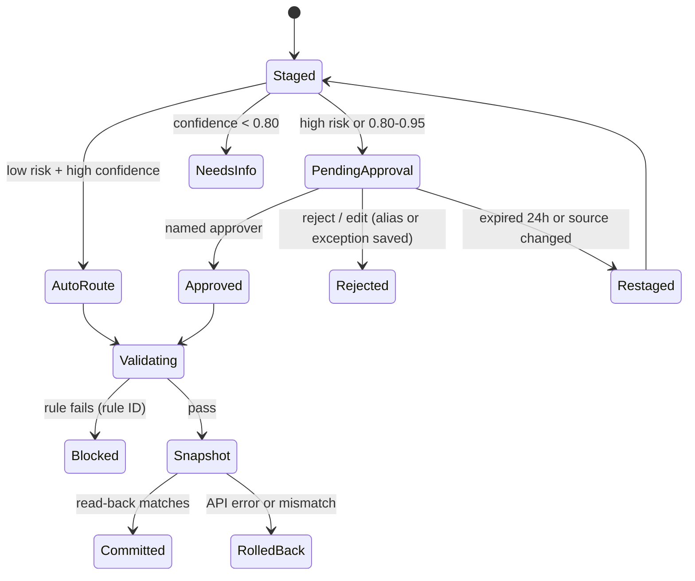
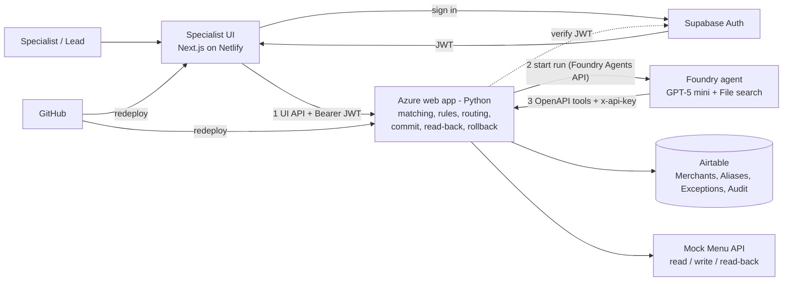
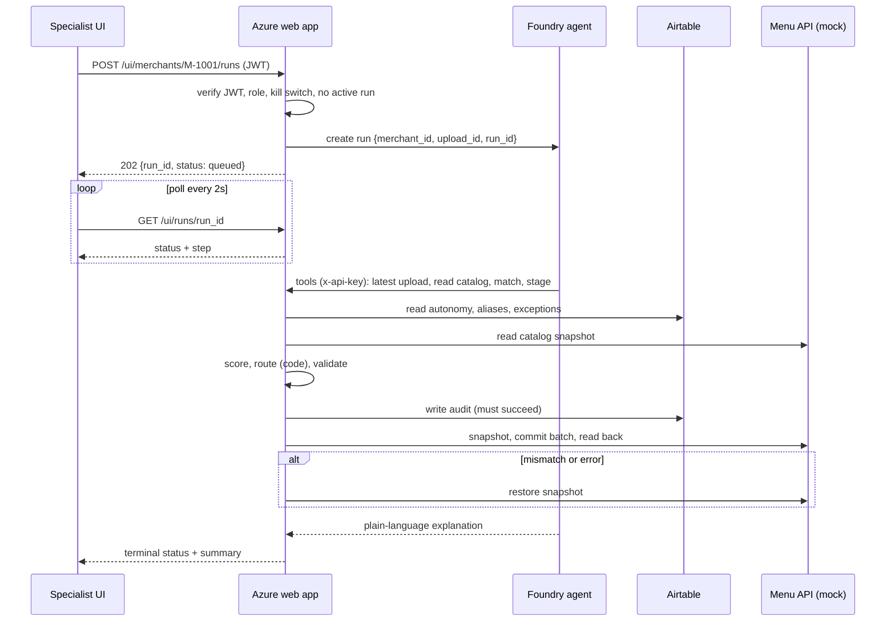

# Menu Reconciliation Agent (MRA) — Engineering Document (High-Level Design)

| | |
|---|---|
| **Source** | `docs/MRA_PRD.md` v1.2 (18 Oct 2026) |
| **Status** | Draft for approval (Stage 1). No implementation begins until approved. |
| **Repo scope** | The **Specialist UI** (Next.js, Netlify). The Azure web app, Foundry agent and Airtable are **external systems**, specified here by contract and data model. |
| **Tags** | `[Verify]` = PRD flags it as unconfirmed. `[Proposed]` = starting value, not validated. |

> **Guiding principle: the AI proposes, the code decides.** The Foundry agent suggests and explains. The Azure web app approves, blocks or routes each change. The UI never talks to Foundry or Airtable, and never holds the agent API key.

---

## 1. Executive Summary

- **Project:** Menu Reconciliation Agent for DoorDash Merchant Operations.
- **Business goal:** Cut a specialist's reconciliation time per merchant-month from ~25 min to ≤10 min (≥60%) with no new errors on the live menu.
- **Problem:** A merchant's POS menu and DoorDash catalog drift. Stale availability causes cancellations and refunds; wrong prices cause margin loss and support contacts. Manual spreadsheet + portal reconciliation is slow and unaudited.
- **Solution:** The agent compares the POS export with the DoorDash menu, stages every **price and availability** difference as a reviewable diff, auto-commits only low-risk high-confidence changes, routes risky ones to a human, validates everything with deterministic code, and rolls back on failure.
- **Target users:** Merchant Operations Specialist (primary), Operations Team Lead (secondary).
- **Success criteria (from PRD):**

| Metric | Target |
|---|---|
| Precision of committed changes | ≥99% auto path, ≥98.5% blended |
| Manual reconciliation time | ≥60% reduction (≤10 min) |
| Auto-commit coverage | 55–70% |
| Detection recall | ≥90% |
| Calibration error (ECE) | ≤0.05 |
| Rollback | rate <2%, 100% exact restore |
| Reviewer reject/edit rate | <10% |
| Cost | ≤$0.05 per merchant-week |
| Injected failures rolled back | 100% |

- **Roadmap:** MVP 6 wks → MVP 1 3 wks → Launch 3 wks (12 weeks).
- **What this repo delivers:** the Specialist UI (US-15), the only interface for specialists and leads.

---

## 2. Product Scope

### In scope (MVP)
- Change types: **price mismatch** on existing items; **availability** (in/out of stock).
- Merchants: single-location, English, US-style menus with CSV/JSON POS export; ≤500 items; file ≤5 MB `[Proposed]`.
- Conditional autonomy: low-risk + high-confidence auto-commit; else human; low confidence → "needs info".
- Specialist UI: sign-in, merchants, upload, reconcile, review queue, run summary, history/audit (CSV export), lead autonomy settings, admin-only demo controls.
- Per-merchant autonomy (shadow / suggest / auto-low-risk), alias/exception memory, stale-approval re-check, deterministic validation, rollback.

### Out of scope (MVP)
New items, descriptions, photos, modifiers, taxes, promotions, categories; chains/multi-location; non-English; menu photo/PDF (OCR); fully unattended operation; merchant-facing UI; Foundry chat as an entry point.

### Future enhancements
| Phase | Item |
|---|---|
| MVP 1 | Metrics dashboard + global kill switch (US-10, US-11b); second POS format; paid Airtable/managed DB |
| Launch | Pilot on sandbox/limited production Menu API; beta → launch gates |
| Iteration | Vision/OCR (US-13), digest notifications (US-12), automated recalibration, multi-location, further change types each behind its own gate |

### Not owned by this repo
Matching, scoring, routing, validation, commit, rollback, audit writes, memory writes, Foundry runs, Airtable access, evaluation corpus/gold set.

---

## 3. User Personas

| Persona | Responsibilities | Permissions (role in Supabase `app_metadata.role`) | Primary workflows |
|---|---|---|---|
| **Merchant Operations Specialist** (`specialist`) | Owns ~150–300 merchants; keeps menus correct | View own merchants; upload; start reconcile; review queue (approve/reject/edit); run summary; history/export | Upload → Reconcile → review → verify result |
| **Operations Team Lead** (`lead`) | Accountable for accuracy across team's book; decides autonomy | All specialist rights **plus** autonomy per merchant, kill switch, metrics dashboard, exceptions management | Widen/narrow autonomy; stop all writes; review quality |
| **Admin** (`admin`, capstone) `[Proposed]` | Sets roles; uses demo controls | Lead rights + demo controls (failure injection) | Demo rollback; assign roles |
| **Merchant** | Beneficiary | No UI in MVP | — |

Role assignment owner (lead/admin) in a pilot is an open question (PRD Open Q10).

---

## 4. User Flows

Format: **User Action → Frontend → Backend (Azure web app) → Data → System Response.**

### 4.1 Sign-up / sign-in
Enter email + password → Supabase JS `signUp`/`signInWithPassword`; show verification notice → Supabase Auth sends verification email; on login issues session JWT → Supabase user record → UI stores session, redirects to `/merchants`. Invalid credentials → inline error "Invalid email or password". Unverified email → "Verify your email to continue". No role in token → "Access denied".

### 4.2 Merchants list
Open `/merchants` → React Query `GET /ui/merchants` with `Authorization: Bearer <session JWT>` → web app verifies JWT, resolves role, reads Airtable Merchants + run state → returns each merchant's autonomy, last run, pending count, status → table render. Empty book → "No merchants assigned."

### 4.3 Upload POS export (US-1, FR-1)
Select merchant → choose CSV/JSON → client checks type/size → `POST /ui/merchants/{id}/uploads` (multipart) → web app parses/normalises, rejects bad rows with reasons, stores upload (nothing in Airtable) → upload ID, accepted count, rejected rows (downloadable CSV). Wrong merchant ID in file → blocking error. Valid rows continue.

### 4.4 Reconcile run (US-1, FR-16)
Click **Reconcile** (disabled until an upload exists) → `POST /ui/merchants/{id}/runs` → web app checks no active run (else 409), kill-switch state, creates run record, starts Foundry Agents API run with structured request `{merchant_id, upload_id, run_id}` → returns `run_id`, status `queued` → UI polls `GET /ui/runs/{run_id}` every 2 s showing steps (reading upload → matching → staging → routing → committing). Agent calls web app tools (`x-api-key`); web app matches, stages, scores, routes, validates, commits, reads back, audits. Terminal state → run summary. Timeout at 5 min fails closed ("We couldn't finish this run. Nothing was changed.").

### 4.5 Review queue (US-5, FR-5, FR-18)
Open queue → `GET /ui/merchants/{id}/review` → pending changes grouped by risk tier with before/after, POS row ID, catalog item ID, evidence, agent reason, confidence, age. **Approve** → `POST /ui/changes/{id}/decision {action:"approve"}` → web app records named approver, re-checks staleness (FR-13), validates, snapshots, commits, reads back, audits. **Reject/Edit** → decision with reason/edited value → writes Alias/Exception in Airtable (FR-9) after named approver. **Bulk approve** within a tier → `POST /ui/changes/bulk-decision`. Blocked changes show rule ID and cannot be approved. Expired/changed → re-staged banner.

### 4.6 Run summary (US-3, US-8)
Open run → `GET /ui/runs/{run_id}` → counts (committed, pending, blocked, skipped, rolled back), agent explanation, audit row links. Rolled-back batch → banner "All N items are back to previous values (verified)".

### 4.7 History and audit (US-8)
Filter/search → `GET /ui/merchants/{id}/audit?…` → paged Airtable Audit rows. **Export CSV** → `GET /ui/merchants/{id}/audit.csv` → file download.

### 4.8 Lead settings (US-11a, US-11b, US-10)
Change autonomy → `PUT /ui/merchants/{id}/autonomy` (lead only) → Airtable Merchants updated, audited. Toggle **kill switch** → `PUT /ui/settings/kill-switch` → web app halts writes (≤10 s) → every page shows "Writes are paused by your team lead." Dashboard → `GET /ui/metrics` (MVP 1).

### 4.9 Demo controls (capstone only)
Admin opens `/admin/demo` → picks failure to inject → `POST /ui/demo/inject-failure` → next commit fails → rollback demonstrated and verified.

### 4.10 Empty and error states (from PRD)
| State | Trigger | UI copy |
|---|---|---|
| Nothing to review | No mismatches / all auto-committed | "No changes need your review for M-1001. 12 low-risk changes were applied." |
| No upload found | Reconcile before upload | Disabled button: "Upload a POS export for M-1001 first." |
| Agent unavailable | Foundry run fails/times out | "We couldn't finish this run. Nothing was changed. Try again in a few minutes." |
| Run in progress | Second Reconcile | "A run for M-1001 is already in progress." |
| Rows rejected | Malformed rows | Count + reason per row, CSV download |
| Needs info | No confident match | "We couldn't match these 4 POS items with confidence. Add an alias or skip." |
| Validation blocked | FR-6 rule | Rule ID + reason; no approve action |
| Batch rolled back | API error/read-back mismatch | Banner + audit link |
| Approval expired | >24 h or source changed | "This change is out of date… re-staged." |
| Writes paused | Kill switch | Persistent banner |
| Access denied | No session / wrong role | "You don't have access to this." No data shown |

### 4.11 Approval state machine


---

## 5. Frontend Architecture

### 5.1 Stack
| Concern | Choice |
|---|---|
| Framework | Next.js 14 App Router, TypeScript (strict) |
| Hosting | Netlify (GitHub deploy, `@netlify/plugin-nextjs`) |
| Styling / UI | Tailwind CSS driven by tokens from `docs/design.md`; Radix UI primitives (dialog, dropdown, tabs); lucide-react icons. All colors, spacing, type from the design system |
| Server state | TanStack Query (polling, cache, mutations, optimistic approve) |
| Client state | React context for session/role/kill-switch banner; Zustand only for review-queue selection (bulk) |
| Forms / validation | React Hook Form + Zod |
| Auth | `@supabase/supabase-js` + `@supabase/ssr` (cookie session) |
| Tables | TanStack Table |
| Routing | App Router with route groups `(auth)` and `(app)`; middleware guards session and role |

### 5.2 Routing
| Route | Screen | Role | Priority |
|---|---|---|---|
| `/login`, `/signup`, `/verify` | Sign-in | public | P0 |
| `/merchants` | Merchants | specialist+ | P0 |
| `/merchants/[id]/upload` | Upload | specialist+ | P0 |
| `/merchants/[id]/runs/[runId]` | Reconcile progress + run summary | specialist+ | P0 |
| `/merchants/[id]/review` | Review queue | specialist+ | P0 |
| `/merchants/[id]/history` | History and audit | specialist+ | P0 |
| `/settings` | Lead settings: autonomy | lead+ | P0 |
| `/settings/dashboard`, kill switch | Dashboard, kill switch | lead+ | P1 (MVP 1) |
| `/admin/demo` | Demo controls | admin | Capstone |

### 5.3 Auth/route guard
```mermaid
flowchart TD
    R[Request] --> M{middleware: session cookie valid?}
    M -- no --> L[/login]
    M -- yes --> V{email verified?}
    V -- no --> VF[/verify]
    V -- yes --> RL{role allowed for route?}
    RL -- no --> D[Access denied page]
    RL -- yes --> P[Render page]
```
The UI role check is for UX only. The web app re-verifies the JWT and role on every call (FR-17).

### 5.4 Component hierarchy
```
RootLayout (providers: Query, Session, Toaster)
├─ (auth) AuthLayout → LoginForm · SignupForm · VerifyNotice
└─ (app) AppShell
   ├─ TopBar (user menu, role badge)
   ├─ WritesPausedBanner (global, from /ui/settings)
   ├─ SideNav
   └─ pages
      ├─ MerchantsPage → MerchantTable → AutonomyBadge · PendingCount
      ├─ UploadPage → FileDropzone · UploadResult · RejectedRowsTable
      ├─ RunPage → RunProgress (steps) · RunSummary → CountCards · AgentExplanation · RollbackBanner
      ├─ ReviewPage → TierGroup → ChangeRow → EvidencePanel · ConfidenceChip · RiskChip
      │               ├─ DecisionActions (approve/reject/edit) · EditPriceDialog · BulkApproveBar
      │               └─ NeedsInfoList · BlockedRow(rule ID)
      ├─ HistoryPage → AuditFilters · AuditTable · ExportCsvButton
      ├─ SettingsPage → AutonomySelect · KillSwitchToggle · MetricsDashboard (MVP 1)
      └─ DemoPage → FailureInjectionForm
```

### 5.5 UX states (every data view)
- **Loading:** skeletons (table rows, cards). **Empty:** copy from §4.10. **Error:** inline message + retry; global error boundary for unexpected faults.
- **Run progress:** stepper with polling; survives refresh (state from server, not client).
- **Optimistic updates:** only for approve/reject visual state; reverted on server error. Commit results always come from the server.
- **Responsive:** desktop-first (specialist workstation), usable at tablet width; review table collapses to cards below `md`.
- **Accessibility:** WCAG 2.1 AA, keyboard-operable queue (A approve, R reject, E edit; `?` shortcut help), focus management in dialogs, `aria-live` for run status and banners, color never the only risk indicator.

### 5.6 Security (browser)
No API key, Foundry credential or Airtable token in the bundle. Only `NEXT_PUBLIC_SUPABASE_URL`, `NEXT_PUBLIC_SUPABASE_ANON_KEY` and `NEXT_PUBLIC_API_BASE_URL`. Bearer token attached by one API client module. CSP and CORS restrict to the Netlify origin and web app origin.

---

## 6. Backend Architecture

The backend is the existing **Azure web app (Python)**, extended for the UI. It is specified here as the contract the UI depends on.

### 6.1 Systems


### 6.2 Run sequence


### 6.3 Core web app systems
| System | Responsibility |
|---|---|
| **Authn** | Verify Supabase JWT (signature, expiry, audience); reject unverified emails |
| **Authz** | Role from `app_metadata.role`: specialist (upload, reconcile, review), lead (+settings, kill switch), admin (+demo). Merchant ownership checks `[Proposed]` |
| **Agent tool API** | 10 OpenAPI operations at `/openapi.json`; `x-api-key` required (FR-14); `/health` |
| **UI API** | Endpoints in §9 (FR-15); separate router from agent tools |
| **Run orchestrator** | Creates run, starts Foundry run (managed identity preferred `[Proposed]`), one run per merchant, 5-min timeout fails closed (FR-16) |
| **Matching** | exact → approved alias → fuzzy top-5 (rapidfuzz) → LLM adjudication over closed list or `no_match` |
| **Diff/staging** | Versioned staged diff persisted across restarts (FR-3) `[Verify storage]` |
| **Scoring and routing** | Calibrated confidence; policy as versioned config; autonomy level can only narrow rules |
| **Validation (FR-6)** | price >0 and 0.2×–5× last known; currency/decimals; ID exists and unique; availability enum; ≤25% of menu per batch; Exceptions excluded; schema valid |
| **Commit/rollback (FR-7)** | Snapshot → batch commit with idempotency key → read-back → restore on any failure (<60 s) |
| **Audit (FR-8)** | Append-only Airtable Audit; audit write failure blocks commit |
| **Memory (FR-9)** | Alias/Exception rows written only after a named human decision |
| **Staleness (FR-13)** | 24 h expiry; before commit re-read latest upload + catalog; changed items re-staged |
| **Kill switch** | Global flag checked before every write; effective ≤10 s |
| **Middleware** | CORS allow-list (Netlify origin only), request IDs, rate limiting, structured logging |
| **Error handling** | Uniform error envelope (§9.1); fail closed everywhere |

### 6.4 Required additions to the existing web app
New UI router; Supabase JWT verification; role enforcement; CORS; run records and Foundry run start; decisions endpoints; audit export; settings/kill switch; move upload page and demo controls to API endpoints.

---

## 7. Database Design and Schema

There is no relational database in this repo. Stores are external; the UI sees them only through the API. Field lists are inferred from the PRD and must be confirmed against the Airtable base `[Verify]`.

### 7.1 Airtable (written only by the web app)

**Merchants** — per-merchant config.
| Field | Type | Notes |
|---|---|---|
| merchant_id | text (PK) | e.g. `M-1001`, unique |
| name | text | |
| autonomy | single select | `shadow` \| `suggest` \| `auto_low_risk`; default `shadow` |
| owner_user_id | text | Supabase user ID `[Proposed]` |
| updated_by / updated_at | text / datetime | |

**Aliases** — approved mappings (relationship: many → one Merchant).
| Field | Type | Notes |
|---|---|---|
| merchant_id | link | |
| pos_item_key | text | POS name/ID |
| catalog_item_id | text | |
| approved_by | text | named human, required |
| approved_at | datetime | |
Unique (merchant_id, pos_item_key). Index: merchant_id.

**Exceptions** — locks.
| Field | Type | Notes |
|---|---|---|
| merchant_id | link | |
| catalog_item_id | text | |
| lock_reason | single select | `promo_locked` \| `merchant_locked` |
| created_by / created_at | text / datetime | |

**Audit** — append-only.
| Field | Type |
|---|---|
| audit_id | text (PK) |
| timestamp | datetime |
| merchant_id, run_id, change_id | text |
| item_ids | text (POS + catalog) |
| before, after | text (JSON) |
| evidence | long text |
| confidence | number |
| risk_tier | single select |
| route | `auto` \| `approval` \| `skip` |
| approver | text (blank for agent) |
| validation_result | `pass` \| `blocked:<rule_id>` |
| status | `committed` \| `rolled_back` \| `blocked` \| `skipped` \| `rejected` |
| model_version, policy_version | text |

Constraints: Audit is never updated or deleted. Aliases are never written without `approved_by`.
Limits: Free plan 1,000 API calls/month and 5 req/s per base. Not sufficient for a pilot (paid plan or managed DB before Launch).

### 7.2 Web app state `[Verify storage location]`
| Object | Key fields | Retention |
|---|---|---|
| Upload | upload_id, merchant_id, uploaded_by, row counts, rejected rows, raw file ref | 30 days `[Proposed]` |
| Catalog snapshot | merchant_id, timestamp, items | per run |
| Staged diff / Change | change_id, run_id, merchant_id, pos_row_ref, catalog_item_id, field (`price`\|`availability`), before, after, confidence, risk_tier, route, state (see §4.11), expires_at | until resolved |
| Prior-value snapshot | batch_id, items, values | 90 days `[Proposed]` |
| Run | run_id, merchant_id, upload_id, status, step, foundry_run_id, started_by, started_at, finished_at, explanation, counts | with audit |
| Settings | kill_switch (bool, set_by, set_at) | persistent |

State must survive restarts (NFR).

### 7.3 Supabase Auth (sign-in only)
Users: id, email, email_confirmed_at, `app_metadata.role` (`specialist` \| `lead` \| `admin`). Menu data is never stored in Supabase.

### 7.4 Retention
Audit 24 months; snapshots 90 days; uploads 30 days `[Proposed]`.

---

## 8. AI Architecture

| Aspect | Design |
|---|---|
| **Provider / model** | Azure AI Foundry Agent Service, GPT-5 mini (Azure OpenAI); version pinned; swappable in agent config |
| **Entry** | Web app starts a run with a structured request `{merchant_id, upload_id, run_id}`. Specialists never send free text to the agent |
| **Tools** | 10 OpenAPI operations on the web app (parse export, read catalog, match, detect mismatch, score, route, validate, commit, verify read-back, rollback, write audit — mapped to operation names `[Verify]`) with `x-api-key` via Foundry connection `menu-api-key` |
| **Knowledge** | File search (managed vector store, text embedding model) over 10 policy files. Policy retrieval only; never used for item matching |
| **Prompt strategy** | One agent, versioned instructions + policy files in GitHub. Step table: plan/explain (agent) · candidates (code) · adjudicate ambiguous (GPT-5 mini, few-shot incl. hard negatives, structured output, closed list or `no_match`, quote evidence + reason code) · route/validate/commit/rollback (code) |
| **Two-sample check** | In the 0.80–0.95 band, two samples; disagreement escalates to human `[Verify in build]` |
| **Structured output** | JSON validated against schema by the web app; code drives decisions |
| **Memory** | Airtable aliases/exceptions only, after named human approval; no model-written memory |
| **Token/context** | 32K sufficient; one merchant's ambiguous items per call. Assumed ~18K in / 1.8K out per run |
| **Rate limiting / concurrency** | One run per merchant; 5-min timeout; per-user rate limits on UI API |
| **Cost controls** | ≤$0.05 per merchant-week (modelled ≈$0.008); alert at 80% of guardrail; Foundry tracing |
| **Grounding** | LLM returns IDs and reason codes, never prices/availability; values copied by code from POS rows; explanation may not introduce numbers/names absent from tool output (code-checked) |
| **Prompt-injection defense** | Item names wrapped as untrusted data; agent has no write path bypassing web app rules; adversarial set of 100 cases |
| **No temperature** | Reasoning model; consistency comes from closed candidates, schema and code checks |
| **Fallback** | Foundry/model outage → run fails closed ("Agent unavailable"); specialists can still review and approve staged changes (approvals need no agent) |
| **Evaluation** | HHH: gold set (400 double-labelled hard pairs, 100 adversarial), regression gate (<0.5 pp precision loss), Wilson 95% intervals, LLM-as-judge for explanations only |

UI implications: render the agent explanation as plain text only (no HTML/markdown execution), label it "AI-generated explanation", and never show agent-supplied values as authoritative; values shown come from staged change fields.

---

## 9. API Specification

### 9.1 Conventions
- Base: `NEXT_PUBLIC_API_BASE_URL`. JSON. All `/ui/*` calls need `Authorization: Bearer <Supabase JWT>`.
- Error envelope: `{ "error": { "code": "string", "message": "string", "details": {…}, "request_id": "string" } }`.
- Common errors: `401 unauthenticated`, `403 forbidden`, `404 not_found`, `409 conflict`, `422 validation_failed`, `429 rate_limited`, `503 agent_unavailable` / `writes_paused`.
- Roles: S = specialist+, L = lead+, A = admin.

### 9.2 UI endpoints (consumed by this repo)

| Method | Path | Purpose | Auth |
|---|---|---|---|
| GET | `/ui/me` | Current user, role | S |
| GET | `/ui/merchants` | Merchant list | S |
| POST | `/ui/merchants/{id}/uploads` | Upload POS export | S |
| GET | `/ui/merchants/{id}/uploads/{uploadId}/rejected.csv` | Rejected rows | S |
| POST | `/ui/merchants/{id}/runs` | Start reconcile | S |
| GET | `/ui/runs/{runId}` | Run status/summary | S |
| GET | `/ui/merchants/{id}/review` | Pending changes | S |
| POST | `/ui/changes/{changeId}/decision` | Approve / reject / edit | S |
| POST | `/ui/changes/bulk-decision` | Bulk approve in tier | S |
| GET | `/ui/merchants/{id}/audit` | Audit rows | S |
| GET | `/ui/merchants/{id}/audit.csv` | Audit export | S |
| PUT | `/ui/merchants/{id}/autonomy` | Set autonomy | L |
| GET/PUT | `/ui/settings/kill-switch` | Read/toggle kill switch | S read / L write |
| GET | `/ui/metrics` | Dashboard (MVP 1) | L |
| GET/POST/DELETE | `/ui/merchants/{id}/exceptions` | Manage locks | L |
| POST | `/ui/demo/inject-failure` | Failure injection | A |

### 9.3 Detailed contracts

**GET `/ui/me`** → `200 { "user_id": "uuid", "email": "string", "role": "specialist|lead|admin" }`.

**GET `/ui/merchants`** → `200 { "merchants": [{ "merchant_id": "M-1001", "name": "string", "autonomy": "shadow|suggest|auto_low_risk", "last_run_at": "iso|null", "last_run_status": "string|null", "pending_count": 0, "has_upload": true, "active_run_id": "string|null" }] }`.

**POST `/ui/merchants/{id}/uploads`** — multipart `file` (CSV/JSON).
Validation: extension/MIME csv/json, ≤5 MB, ≤500 items, merchant matches. Response `201 { "upload_id": "string", "accepted_rows": 120, "rejected_rows": [{ "row": 7, "reason": "price missing" }], "total_rows": 123 }`. Errors: `422 wrong_merchant`, `413 file_too_large`, `422 unsupported_format`.

**POST `/ui/merchants/{id}/runs`** — body `{ "upload_id": "string" }`.
Response `202 { "run_id": "string", "status": "queued" }`. Errors: `409 run_in_progress`, `409 no_upload`, `503 writes_paused` (only blocks commit stage; run may still stage in shadow), `503 agent_unavailable`.

**GET `/ui/runs/{runId}`** → `200`:
```json
{
  "run_id": "string", "merchant_id": "M-1001",
  "status": "queued|running|succeeded|failed|timed_out",
  "step": "reading_upload|matching|staging|routing|committing|verifying|done",
  "started_at": "iso", "finished_at": "iso|null",
  "counts": { "committed": 0, "pending": 0, "blocked": 0, "skipped": 0, "rolled_back": 0 },
  "explanation": "string|null",
  "rolled_back": { "batch_id": "string", "items": 18, "verified": true },
  "audit_refs": ["audit_id"]
}
```

**GET `/ui/merchants/{id}/review`** → `200`:
```json
{
  "merchant_id": "M-1001",
  "autonomy": "suggest",
  "tiers": [{
    "tier": "high_risk|medium_confidence",
    "changes": [{
      "change_id": "string", "field": "price|availability",
      "item_name": "string", "pos_row_id": "string", "catalog_item_id": "string",
      "before": "string|number", "after": "string|number",
      "evidence": "string", "reason_code": "string", "agent_reason": "string",
      "confidence": 0.87, "route": "approval", "state": "pending|blocked|expired",
      "blocked_rule_id": "string|null", "blocked_reason": "string|null",
      "age_seconds": 120, "expires_at": "iso"
    }]
  }],
  "needs_info": [{ "pos_row_id": "string", "item_name": "string", "reason": "string" }]
}
```

**POST `/ui/changes/{changeId}/decision`** — body `{ "action": "approve|reject|edit", "edited_value": number|string|null, "reason": "string|null" }`.
Validation: `edit` requires `edited_value` (price >0, ≤2 decimals; availability enum); `reject` requires `reason`; blocked change → `409 blocked`. Response `200 { "change_id": "string", "state": "committed|rejected|restaged|blocked|rolled_back", "audit_id": "string", "alias_saved": true }`. Errors: `409 expired_restaged`, `409 writes_paused`, `403 forbidden`.

**POST `/ui/changes/bulk-decision`** — `{ "change_ids": ["string"], "action": "approve", "tier": "string" }`. Max 100 per call; all must be same tier; returns per-change results array.

**GET `/ui/merchants/{id}/audit`** — query `from`, `to`, `status`, `route`, `q`, `page`, `page_size` (≤100). Response `{ "rows": [Audit…], "page": 1, "total": 0 }`.

**GET `…/audit.csv`** — `text/csv`, same filters.

**PUT `/ui/merchants/{id}/autonomy`** — `{ "autonomy": "shadow|suggest|auto_low_risk" }` → `200 { "merchant_id", "autonomy", "updated_by", "updated_at" }`. Non-lead → `403`.

**PUT `/ui/settings/kill-switch`** — `{ "writes_paused": true }` → `200 { "writes_paused": true, "set_by": "string", "set_at": "iso" }`.

**POST `/ui/demo/inject-failure`** — `{ "merchant_id": "string", "mode": "api_error|readback_mismatch|partial_batch" }` → `202`.

### 9.4 Agent tool endpoints (external; not called by the UI)
10 OpenAPI operations at `/openapi.json`, secured by `x-api-key` (FR-14). Without a valid key they return `401` and no merchant data. Operation names `[Verify]`.

### 9.5 Routing policy (versioned config in the web app)
| Change | Auto-commit | Human approval | No action |
|---|---|---|---|
| Price | conf ≥0.95 and within ±10% and <$5 | 0.80–0.95, or >±10% or ≥$5 | <0.80 |
| Mark unavailable | conf ≥0.90 and POS out of stock | 0.80–0.90 | <0.80 |
| Mark available again | never in MVP | always (≥0.80) | <0.80 |

Autonomy: `shadow` = no writes; `suggest` = everything to approval; `auto_low_risk` = policy above. Autonomy can only narrow.

---

## 10. Feature Breakdown

### Phase 1 — MVP (6 weeks)
| Feature | Description | Acceptance criteria | Dependencies |
|---|---|---|---|
| F1 Auth and roles (FR-17) | Supabase email/password, verification, role guards | Unauthed users see no data; role gates enforced; JWT on every call | Supabase project; web app JWT verification |
| F2 Merchants screen (FR-15) | Book with autonomy, last run, pending | Loads <2 s; links to all actions | `/ui/merchants` |
| F3 Upload (US-1, FR-1) | CSV/JSON upload with results | 100% rows accepted or rejected with reason; wrong merchant blocked | `/uploads` |
| F4 Reconcile run (US-1, FR-16) | Start, poll, summary | One run per merchant; step progress; timeout copy; 500 items <30 s parse | `/runs`, Foundry |
| F5 Review queue (US-3, US-5, FR-5) | Evidence, approve/reject/edit, bulk, approver recorded | Median review ≤20 s/item; blocked rows not approvable; keyboard accessible | `/review`, `/decision` |
| F6 Stale handling (US-14, FR-13) | Expiry + re-stage messaging | Expired item shows re-stage banner; no commit of changed data | web app |
| F7 Run summary and rollback display (US-7) | Counts, explanation, rollback banner | Rollback banner shows verified restore | `/runs` |
| F8 History and audit (US-8) | Search + CSV | Export matches filters | `/audit` |
| F9 Memory feedback (US-9, FR-9) | Reject/edit saves alias/exception | UI shows "alias saved" | `/decision` |
| F10 Autonomy settings (US-11a) | Per-merchant level (lead) | Non-leads cannot change; change audited | `/autonomy` |
| F11 Demo controls | Admin failure injection | Hidden from non-admin | `/demo` |
| F12 Core UX states | All §4.10 states | Each state has a test | — |

### Phase 2 — MVP 1 (3 weeks)
| Feature | Acceptance criteria | Dependencies |
|---|---|---|
| Metrics dashboard (US-10, FR-10) | All metric-table items, split auto vs human | `/ui/metrics` |
| Kill switch (US-11b) | Halts writes ≤10 s; banner everywhere | web app flag |
| Exceptions management UI | Lead can add/remove locks | `/exceptions` |
| Second POS format; paid Airtable/managed DB | ≥40% time reduction on pilot merchants | backend |

### Phase 3 — Launch (3 weeks) and beyond
| Feature | Acceptance criteria | Dependencies |
|---|---|---|
| Pilot hardening | ≥60% time cut; ≥99% auto precision over ≥1,000 decisions; ECE ≤0.05; no P0/P1 for 2 wks | real/sandbox Menu API |
| Satisfaction prompt | 1–5 rating after each run; ≥4.0 | `/ui/feedback` `[Proposed]` |
| Digest notifications (US-12) P2 | Pending items by age | email/Slack |
| OCR upload (US-13) P2 | Photo/PDF to approval by default | vision pipeline |

---

## 11. Folder Structure

```
menu-agent-os/
├─ docs/
│  ├─ MRA_PRD.md · design.md
│  ├─ engineering/ (engineering-doc.md, implementation-specs.md)
│  ├─ specs/                          # Stage 2 output + supabase-schema/auth notes
│  └─ security/                       # Stage 7
├─ src/
│  ├─ app/
│  │  ├─ (auth)/login · signup · verify
│  │  ├─ (app)/
│  │  │  ├─ layout.tsx                # AppShell, banner, providers
│  │  │  ├─ merchants/page.tsx
│  │  │  ├─ merchants/[id]/upload · review · history · runs/[runId]
│  │  │  ├─ settings/page.tsx · settings/dashboard
│  │  │  └─ admin/demo/page.tsx
│  │  ├─ access-denied/page.tsx
│  │  ├─ layout.tsx · globals.css · error.tsx · not-found.tsx
│  │  └─ auth/callback/route.ts       # Supabase email verification callback
│  ├─ components/
│  │  ├─ ui/                          # design-system primitives (Button, Badge, Dialog…)
│  │  ├─ layout/                      # AppShell, TopBar, SideNav, WritesPausedBanner
│  │  ├─ merchants/ · upload/ · run/ · review/ · history/ · settings/ · admin/
│  ├─ lib/
│  │  ├─ api/                         # typed web app client (client.ts, merchants.ts, runs.ts, review.ts, audit.ts, settings.ts)
│  │  ├─ auth/                        # supabase client/server, role helpers
│  │  ├─ validation/                  # Zod schemas (upload, edit price, forms)
│  │  ├─ format/                      # money, dates, confidence
│  │  └─ constants.ts                 # routes, risk tiers, step labels
│  ├─ hooks/                          # useMerchants, useRunPolling, useReviewQueue, useDecision, useRole
│  ├─ types/                          # api.ts (contract types), domain.ts
│  ├─ middleware.ts                   # session + role route guard
│  └─ styles/tokens.css               # tokens from docs/design.md
├─ tests/
│  ├─ unit/ · integration/ (MSW handlers) · e2e/ (Playwright)
│  └─ mocks/                          # fixtures: merchants, runs, changes
├─ public/
├─ netlify.toml
├─ .env.example                       # Stage 2 output
├─ package.json · tsconfig.json · tailwind.config.ts · next.config.mjs
└─ .github/workflows/ci.yml           # lint, typecheck, tests before deploy
```

---

## 12. Naming Conventions

| Item | Convention | Example |
|---|---|---|
| Component files / components | PascalCase `.tsx` | `ReviewQueue.tsx`, `EvidencePanel.tsx` |
| Route folders | kebab-case; dynamic `[id]` | `app/(app)/merchants/[id]/review/page.tsx` |
| Hooks | `use` + camelCase, file same | `useRunPolling.ts` |
| Services / API modules | camelCase noun, one per resource | `lib/api/review.ts` → `getReviewQueue()` |
| Types / interfaces | PascalCase, no `I` prefix | `ReviewChange`, `RunStatus` |
| Zod schemas | camelCase + `Schema` | `editPriceSchema` |
| Utilities | camelCase | `formatMoney.ts` |
| Tests | `<unit>.test.ts(x)`, e2e `<flow>.spec.ts` | `formatMoney.test.ts`, `approve-change.spec.ts` |
| API paths | lowercase, plural nouns, kebab-case, `/ui/` prefix | `/ui/merchants/{id}/runs` |
| JSON fields | snake_case (match web app) | `pos_row_id`; mapped to camelCase only inside `lib/api` |
| Enums / states | lowercase snake_case strings | `auto_low_risk`, `rolled_back` |
| Airtable tables | PascalCase plural; fields snake_case | `Merchants.merchant_id` |
| Env vars | `UPPER_SNAKE_CASE`; browser-safe ones `NEXT_PUBLIC_` | `NEXT_PUBLIC_API_BASE_URL` |
| Config files | tool defaults | `netlify.toml`, `tailwind.config.ts` |
| Git branches / commits | `feat/…`, `fix/…`; conventional commits | `feat(review): bulk approve` |

---

## 13. Testing Strategy

| Level | Scope | Tools | Target |
|---|---|---|---|
| **Unit** | Formatters, Zod schemas, role helpers, routing label logic, API client error mapping, hooks | Vitest, React Testing Library | ≥85% lines on `lib/`, `hooks/`; ≥70% on components |
| **Integration** | Pages against mocked web app (MSW): upload results, run polling states, review decisions incl. 409/422, audit filters, guards | Vitest + RTL + MSW | Every endpoint in §9 has success + error case |
| **E2E** | Critical flows: sign-in; role access; upload → reconcile → approve → audit row; reject → alias saved; rollback banner; kill switch banner; expired change | Playwright (against staging web app or mock server) | 100% of P0 flows |
| **Accessibility** | Axe checks, keyboard-only review | `@axe-core/playwright` | 0 serious violations |
| **Contract** | `types/api.ts` vs web app OpenAPI | schema diff in CI `[Proposed]` | no drift |
| **Security** | No secrets in bundle; CSP; role bypass attempts | grep CI check, Playwright | pass |

CI (GitHub Actions) runs lint, typecheck, unit, integration before Netlify deploy; E2E on main. Batch deploys to conserve Netlify free credits.

**Out of repo (referenced):** backend unit tests (37 existing), gold-set evaluation (precision, recall, ECE, rollback drills, adversarial set), shadow mode, Wilson intervals. Success metrics are validated there, not in UI tests.

---

## 14. Specs to Implementation Mapping

Spec files are produced in Stage 2. Each maps to implementation files and a flow.

| Spec area | Implementation files | Flow spec → code |
|---|---|---|
| Auth and roles | `lib/auth/*`, `middleware.ts`, `(auth)/*`, `hooks/useRole.ts`, `app/auth/callback/route.ts` | Supabase config → client → cookie session → middleware guard → `/ui/me` role → page |
| API client | `lib/api/*`, `types/api.ts` | Contract §9 → typed fetchers → hooks → components |
| Merchants | `merchants/page.tsx`, `components/merchants/*`, `hooks/useMerchants.ts` | `GET /ui/merchants` → table |
| Upload | `merchants/[id]/upload`, `components/upload/*`, `lib/validation/upload.ts` | dropzone → client check → multipart POST → result/rejected CSV |
| Reconcile run | `runs/[runId]/page.tsx`, `components/run/*`, `hooks/useRunPolling.ts` | POST run → poll → stepper → summary |
| Review queue | `review/page.tsx`, `components/review/*`, `hooks/useReviewQueue.ts`, `useDecision.ts`, `lib/validation/editPrice.ts` | GET queue → decision/bulk → state update → audit link |
| History | `history/page.tsx`, `components/history/*` | filters → paged audit → CSV |
| Settings | `settings/*`, `components/settings/*` | autonomy PUT; kill switch; dashboard (MVP 1) |
| Demo | `admin/demo/page.tsx` | admin-only inject → run summary shows rollback |
| Global states | `components/layout/WritesPausedBanner.tsx`, `error.tsx` | `/ui/settings/kill-switch` poll → banner |
| Design system | `components/ui/*`, `styles/tokens.css` | tokens from `docs/design.md` → primitives → screens |
| Deployment | `netlify.toml`, `.github/workflows/ci.yml`, `.env.example` | PR → CI → Netlify |
| External (web app) | Backend repo; this doc §6.4 | Contract-first; MSW mocks until endpoints ship |

### PRD traceability (this repo)
| PRD item | Covered by |
|---|---|
| US-1, FR-1 | Upload, Reconcile screens |
| US-2, FR-2 | Backend; UI shows match evidence and needs-info list |
| US-3, FR-3 | Review queue, run summary (staged diff display) |
| US-4, FR-4 | Backend routing; UI shows route/tier chips |
| US-5, FR-5, FR-18 | Review queue, decision endpoints |
| US-6, FR-6 | Backend; UI blocked row with rule ID |
| US-7, FR-7 | Backend; UI rollback banner |
| US-8, FR-8 | History and audit, CSV |
| US-9, FR-9 | Reject/edit → alias saved indicator |
| US-10, FR-10 | Dashboard (MVP 1) |
| US-11a | Autonomy settings |
| US-11b | Kill switch (MVP 1) |
| US-12, FR-11 | Deferred P2 |
| US-13, FR-12 | Deferred P2 |
| US-14, FR-13 | Expiry/re-stage UX |
| US-15, FR-15 | Entire UI; no Foundry portal or Airtable needed |
| FR-14 | Backend; UI never uses key |
| FR-16 | Run start and status |
| FR-17 | Auth, roles, JWT per call |

### Open items carried from the PRD
1. Map the 10 logical tools to `/openapi.json` operation names `[Verify]`.
2. Confirm Airtable field lists against the base `[Verify]`.
3. Web app state storage location (must survive restarts) `[Verify]`.
4. Who creates lead accounts and sets roles in a pilot (Open Q10).
5. Whether Foundry runs start cleanly from the web app and typical run duration (Open Q11).
6. Confirm Netlify credit limits and Supabase free-project pause behaviour (unpause before demos).
7. UI-specific `[Proposed]` additions to confirm: `/ui/me`, `/ui/feedback`, exceptions endpoints, merchant ownership checks, `admin` role.
